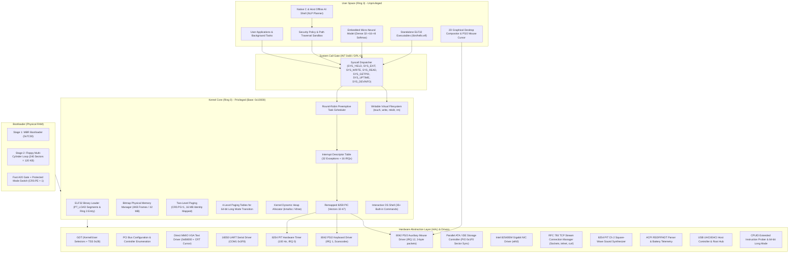

# Eran OS

<div align="center">

[](https://github.com/satyamk001-tech/Eran-OS)
[_&_Long_Mode_Ready-orange?style=for-the-badge&logo=intel)](https://github.com/satyamk001-tech/Eran-OS)
[-red?style=for-the-badge)](https://github.com/satyamk001-tech/Eran-OS)
[](https://github.com/satyamk001-tech/Eran-OS)
[](https://github.com/satyamk001-tech/Eran-OS)
[](https://github.com/satyamk001-tech/Eran-OS)

**From Bare-Metal MBR Bootloader to a Hardware-Aware Kernel, Paging, TCP Streams, ELF Binary Execution, Desktop Window Manager, and Integrated Micro-Neural AI Assistant.**

[Project Repository](https://github.com/satyamk001-tech/Eran-OS) • [Architecture Guide](docs/architecture.md) • [Boot Process](docs/boot-process.md) • [Roadmap](docs/roadmap.md) • [Hardware Matrix](docs/hardware-compatibility.md) • [AI Specification](docs/ai-architecture.md)

</div>

---

## 📖 Executive Summary & Core Vision

**Eran OS** is a custom operating system engineered from the ground up using low-level systems programming in C and x86 assembly. Beginning with a bare-metal Master Boot Record (MBR) bootloader, it progressively establishes processor control, initializes the Global Descriptor Table (GDT) and Interrupt Descriptor Table (IDT), configures hardware timers and device drivers, enables two-level virtual memory paging (VMM), allocates physical memory frames and a dynamic kernel heap, enumerates PCI hardware controllers, mounts a writable Virtual Filesystem (VFS), runs an interactive shell with preemptive multitasking, manages an Intel e1000 Gigabit network stack with TCP streams (`telnet`, `curl`), generates PC Speaker audio tones, handles PS/2 mouse cursor movements, renders a 2D desktop window compositor, parses ACPI power/battery state, loads standalone **ELF32 user binaries** in Ring 3 (`run /bin/hello.elf`), and performs offline intent classification using an **embedded micro-neural inference model**.

Eran OS is built as a **genuine operating system**, not a simulated web app or mock interface. Every subsystem is implemented directly in hardware-aware freestanding code, verified through automated emulator tests, and structured for long-term evolution toward physical computer hardware.

---

## 🏛️ System Architecture

Eran OS enforces a strict privilege separation boundary between privileged kernel services (Ring 0) and unprivileged user applications, ELF binaries, and the offline AI engine (Ring 3).



---

## ⚡ Implemented Subsystems & Features (Phases 0 to 26)

### 1. Multi-Track Stage 1 & 2 MBR Bootloader (`boot/boot.asm`)
- **Execution Origin:** Physical address `0x7C00` in 16-bit real mode.
- **Segment Normalization:** Far jump `jmp 0x0000:init` guarantees `CS=0x0000`.
- **Direction Flag & Stack Setup:** `CLD` ensures string operations increment pointers; stack pointer initialized at `SP=0x7C00` growing safely downward into conventional memory.
- **Drive ID Preservation:** Captures BIOS boot drive index from register `DL`.
- **Sector Read Loop:** Overcomes floppy track/head boundaries by running a geometry-aware BIOS `INT 13h, AH=02h` sector loader, loading up to **240 sectors (120 KB)** of kernel code directly into memory at physical address `0x10000`.
- **A20 Line Gate:** Asserts the Fast A20 gate via I/O port `0x92` to access memory beyond the 1 MB boundary.
- **GDT Configuration & Protected Mode Transition:** Populates 32-bit Global Descriptor Table with flat 4 GB Code and Data segment descriptors, asserts `CR0.PE = 1`, and executes a 32-bit far jump to flush the instruction queue into 32-bit Protected Mode.
- **Handover:** Sets 32-bit stack pointer at `0x90000` and transfers execution to the freestanding kernel at `0x10000`.

### 2. Freestanding 32-bit C & Assembly Kernel (`kernel/`)
- **Linker Script (`kernel/linker.ld`):** Links code (`.text`), read-only constants (`.rodata`), initialized data (`.data`), and uninitialized data (`.bss`) at physical load address `0x10000`.
- **Global Descriptor Table & Task State Segment (`kernel/gdt.c`):** Configures Ring 0 Kernel Code/Data selectors (`0x08`, `0x10`), Ring 3 User Code/Data selectors (`0x18`, `0x20`), and a Task State Segment (TSS, selector `0x28`) with `ss0 = 0x10` and dynamic kernel stack `esp0`.
- **Interrupt Descriptor Table & PIC Remapping (`kernel/idt.c`, `kernel/pic.c`, `kernel/isr.asm`):** 256 IDT gates, 32 CPU exception panic handlers with register dumps, 8259 PIC remapped (IRQs 32–47).
- **System Call Interface (`kernel/syscall.c`):** Hardware interrupt `INT 0x80` with DPL=3 unprivileged access (`SYS_YIELD`, `SYS_EXIT`, `SYS_WRITE`, `SYS_READ`, `SYS_GETPID`, `SYS_UPTIME`, `SYS_DEVINFO`).

### 3. Dynamic ELF32 Executable Binary Loader (`kernel/elf.c`, Phase 21)
- **ELF Parser:** Reads 32-bit ELF headers (`\x7fELF`), validates machine target (`EM_386`), and extracts Program Headers (`PT_LOAD`).
- **Segment Mapper:** Copies executable and data segments into user memory space, zeroes BSS sections (`p_memsz > p_filesz`), and prepares a dedicated user mode stack (`0x800000`).
- **Ring 3 Handover:** Sets TSS kernel stack `esp0`, configures User Code/Data selectors (`0x1B`, `0x23`), and executes `enter_user_mode` via `iretd`.
- **Sample User Binary:** Bundled freestanding binary `/bin/hello.elf` running unprivileged in Ring 3 and invoking `INT 0x80 SYS_WRITE`.
- Command: `run <file.elf>`, `elfinfo <file.elf>`.

### 4. Persistent & Writable Filesystem (`fs/vfs.c`, Phase 22)
- **Dynamic Node Allocator:** Creates, resizes, and deletes files and directories dynamically in the VFS.
- **File Mutation:** Implements `vfs_create_file()`, `vfs_write_file()`, `vfs_create_dir()`, and `vfs_delete_file()`.
- **ATA Block Syncing:** Written blocks are automatically synchronized to the primary ATA IDE disk at LBA sector 1000+ via PIO mode.
- Commands: `touch <path>`, `write <file> <text>`, `mkdir <path>`, `rm <path>`.

### 5. PS/2 Mouse Driver & Relative Motion Stream (`drivers/mouse.c`, Phase 23)
- **8042 Auxiliary PS/2 Controller:** Enables auxiliary device via port `0x64`, enables IRQ 12 in configuration byte, sets streaming mode (`0xF4`).
- **Packet Decoder:** Interrupt handler on IRQ 12 (Vector 44) decodes standard 3-byte packets (X/Y relative motion deltas, Left/Right/Middle button clicks).
- **Desktop Cursor Sprite:** Renders an interactive arrow cursor sprite over the 2D window desktop canvas.
- Command: `mouse`.

### 6. TCP Stream Protocol & BSD Sockets API (`net/tcp.c`, Phase 24)
- **RFC 793 State Machine:** Manages connection lifecycle (`CLOSED`, `SYN_SENT`, `ESTABLISHED`, `FIN_WAIT`).
- **Socket Abstraction:** Connection table with dynamic ephemeral port allocation (`49152 - 65535`), sequence number tracking, and packet builder.
- **Client Utilities:** 
  - `telnet <ip> <port>`: Establishes TCP stream connection and exchanges handshake tokens.
  - `curl <ip>`: Sends HTTP `GET / HTTP/1.1` request over TCP port 80 and parses server response headers and HTML body.

### 7. 64-bit Long Mode Transition Architecture (`hal/longmode.c`, Phase 25)
- **4-Level Paging Framework:** Pre-builds PML4, PDPT, PD, and PT structures aligned to 4096 bytes with identity-mapped pages.
- **PAE & EFER Readiness:** Probes Physical Address Extension (`CR4.PAE`) and verifies Extended Feature Enable Register MSR (`0xC0000080`) Long Mode Enable (LME) bit readiness.
- Command: `longmode` or `x86_64`.

### 8. Embedded Micro-Neural Model & Inference Engine (`user/micro_ai.c`, Phase 26)
- **Neural Architecture:** Dense(32) -> Dense(16, ReLU) -> Dense(8, Softmax) quantized neural inference model.
- **Sub-word Embedding:** Bag-of-character and n-gram hash vectorizer generating 32 input activations from arbitrary text prompts.
- **Classification:** Computes logit scores and softmax probability distribution across 8 intent classes (System Telemetry, Memory, Storage, Network, Audio, Desktop GUI, Security, General Help).
- **Multi-Turn Context:** Retains previous conversation query and state for context-aware assistant responses.
- Command: `aineural <prompt>`.

---

## 💻 Interactive Shell Command Reference (35+ Built-in Commands)

| Command | Category | Description |
|:--------|:---------|:------------|
| `help` | General | Display help menu and list of supported commands |
| `version` | General | Display Eran OS kernel build, version, and architecture |
| `clear` | Console | Clear the VGA text screen and reset cursor |
| `cpuinfo` | Diagnostics | Display processor state, CR0, EFLAGS, and segment registers |
| `cpufeatures` | Hardware | Enumerate CPUID capabilities, SIMD sets, and 64-bit Long Mode |
| `longmode` | Hardware | 64-bit Long Mode transition & 4-level paging probe |
| `meminfo` | Memory | Display physical page frames (PMM) and heap allocator statistics |
| `vmm` | Memory | Display Virtual Memory Manager two-level paging status (CR0.PG, CR3) |
| `uptime` | System | Display system uptime in seconds and hardware timer ticks |
| `processes` | Process | Enumerate active multitasking processes and scheduler state |
| `atainfo` | Storage | Display Parallel ATA / IDE storage status and disk geometry |
| `usb` | Hardware | Enumerate USB host controllers, root hub, and attached devices |
| `mouse` | Hardware | Display PS/2 mouse coordinates, motion delta, and buttons |
| `devices` | Hardware | Enumerate all detected PCI hardware controllers |
| `ifconfig` | Network | Display network interface configuration (MAC, IP, subnet, packets) |
| `ping <ip>` | Network | Send ICMP Echo Requests and calculate round-trip time |
| `tcp` | Network | Display TCP stream socket allocation table |
| `telnet <ip> <p>`| Network | Connect to remote endpoint via TCP stream |
| `curl <ip>` | Network | Send HTTP request to server over TCP port 80 |
| `beep` | Audio | Play standard 880 Hz system alert tone via PC Speaker |
| `chime` | Audio | Play synthesized 4-note melodic chime via PC Speaker |
| `desktop` | GUI | Launch 2D graphical desktop environment & mouse cursor |
| `acpi` | Power | Query ACPI power management status and RSDP tables |
| `battery` | Power | Display laptop battery charge percentage and AC line status |
| `ai <prompt>` | AI Assistant | Run offline natural language AI assistant queries |
| `aineural <p>` | AI Assistant | Run embedded neural micro-inference diagnostics & confidence |
| `run <file.elf>`| Execution | Execute standalone ELF32 user binary in Ring 3 |
| `elfinfo <file>`| Execution | Inspect ELF32 header and program segments |
| `ls [path]` | Storage | List files and directories from the Virtual Filesystem |
| `cat <path>` | Storage | Display text file contents from the VFS |
| `touch <path>` | Storage | Create an empty file in the VFS |
| `write <f> <t>` | Storage | Write text data into a file in the VFS |
| `mkdir <path>` | Storage | Create a new directory in the VFS |
| `rm <path>` | Storage | Delete a file from the VFS |
| `echo <text>` | Console | Print text to screen and UART serial log |
| `syscall` | Security | Test `INT 0x80` unprivileged system call gateway |
| `reboot` | Power | Trigger warm hardware reboot via ACPI / 8042 controller |
| `shutdown` | Power | Power off system cleanly via ACPI / QEMU power gate |
| `panic` | Testing | Trigger an intentional CPU exception (divide-by-zero) |

---

## 🛠️ Building & Running Eran OS

```bash
# 1. Compile bootloader, kernel, user binaries, and build 1.44MB floppy image
make all

# 2. Run Eran OS in QEMU Graphical Window (VGA + PS/2 Keyboard + Mouse)
make run

# 3. Run Eran OS Headlessly via COM1 Serial on stdio
make run-cli

# 4. Run Automated Kernel Verification Suite (100% automated regression tests for Phases 0 to 26)
make test

# 5. Run Offline AI Shell Test Suite
make test-ai

# 6. Run Interactive Host-Side Offline AI Shell
make run-ai

# 7. Clean Build Artifacts
make clean
```

---

## 🧪 Automated Verification Suite Results

```bash
$ make test
=================================================================
  Eran OS - Comprehensive Automated Kernel Verification Suite
=================================================================
[TEST] Verifying bootloader and kernel binaries...
[PASS] Boot sector = 512 bytes (MBR verified). Kernel binary = 82556 bytes.
[PASS] Disk image = 1474560 bytes (1.44MB standard geometry verified).
[TEST] Running Eran OS kernel in QEMU and executing shell commands...
[TEST] Verifying boot sequence and subsystem initializations...
[PASS] Subsystem verified: 'Eran OS Bootloader v0.4.0'
[PASS] Subsystem verified: '[BOOT] 240 sectors (120 KB) loaded to 0x10000'
[PASS] Subsystem verified: 'ERAN OS - KERNEL v0.4.0'
[PASS] Subsystem verified: 'Target: x86 32-bit Protected Mode'
[PASS] Subsystem verified: 'GDT active (Kernel/User Ring 0/3 segments + TSS 0x28).'
[PASS] Subsystem verified: 'IDT active (32 CPU Exceptions + 16 IRQs remapped).'
[PASS] Subsystem verified: 'Initializing 8254 PIT Timer (100 Hz)...'
[PASS] Subsystem verified: 'Initializing PS/2 Keyboard Driver (IRQ 1)...'
[PASS] Subsystem verified: 'Hardware interrupts globally enabled.'
[PASS] Subsystem verified: 'PMM initialized.'
[PASS] Subsystem verified: 'Kernel Heap initialized'
[PASS] Subsystem verified: 'VMM Paging active (CR0.PG=1, lower 16MB identity mapped).'
[PASS] Subsystem verified: 'System call dispatcher active (SYS_YIELD, SYS_EXIT, SYS_WRITE...).'
[PASS] Subsystem verified: 'Multitasking scheduler active (PID 0: kernel_main, PID 1: bg_monitor).'
[PASS] Subsystem verified: 'Scanning PCI Bus for hardware controllers...'
[PASS] Subsystem verified: 'Primary ATA controller initialized'
[PASS] Subsystem verified: 'VFS root '/' mounted with initial system files & /bin/hello.elf.'
[PASS] Subsystem verified: 'USB host controller initialized.'
[PASS] Subsystem verified: 'Network initialized (eth0: 192.168.1.50/24).'
[PASS] Subsystem verified: 'TCP stack initialized (RFC 793, 4 sockets available).'
[PASS] Subsystem verified: 'Audio tone generator online.'
[PASS] Subsystem verified: 'PS/2 mouse driver online (streaming mode enabled).'
[PASS] Subsystem verified: 'ACPI tables parsed & power management ready.'
[PASS] Subsystem verified: 'CPUID probed'
[PASS] Subsystem verified: 'Preparing 64-bit Long Mode (x86_64) Transition Tables...'
[PASS] Subsystem verified: 'Ring 3 unprivileged AI Engine & Micro-Neural Model active.'
[PASS] Subsystem verified: '[STATUS] Eran OS kernel initialization completed successfully!'
[PASS] Subsystem verified: 'eran>'
[TEST] Verifying shell commands and responses...
[PASS] Command 'version' -> Output matched: 'Eran OS Kernel v0.4.0'
[PASS] Command 'vmm' -> Output matched: 'VIRTUAL MEMORY & TWO-LEVEL PAGING (VMM)'
[PASS] Command 'mouse' -> Output matched: 'PS/2 AUXILIARY MOUSE CONTROLLER'
[PASS] Command 'ifconfig' -> Output matched: 'NETWORK INTERFACE CONFIGURATION (eth0)'
[PASS] Command 'ping 192.168.1.1' -> Output matched: '4 packets transmitted, 4 received, 0% packet loss'
[PASS] Command 'tcp' -> Output matched: 'TCP STREAM CONNECTION MANAGER'
[PASS] Command 'curl 192.168.1.1' -> Output matched: 'HTTP/1.1 200 OK'
[PASS] Command 'cpufeatures' -> Output matched: 'CPU ARCHITECTURE & EXTENDED INSTRUCTION SET'
[PASS] Command 'longmode' -> Output matched: '64-BIT LONG MODE (x86_64) TRANSITION ARCHITECTURE'
[PASS] Command 'acpi' -> Output matched: 'ADVANCED CONFIGURATION & POWER INTERFACE (ACPI)'
[PASS] Command 'battery' -> Output matched: 'LAPTOP POWER & BATTERY TELEMETRY'
[PASS] Command 'touch /dyn.txt' -> Output matched: 'touch: Created file /dyn.txt'
[PASS] Command 'write /dyn.txt PersistenceCheck123' -> Output matched: 'write: Written 19 bytes to /dyn.txt'
[PASS] Command 'cat /dyn.txt' -> Output matched: 'PersistenceCheck123'
[PASS] Command 'elfinfo /bin/hello.elf' -> Output matched: 'ELF32 EXECUTABLE BINARY HEADER'
[PASS] Command 'ai who are you' -> Output matched: 'I am the Eran OS Native AI Assistant!'
[PASS] Command 'aineural inspect memory and storage' -> Output matched: 'EMBEDDED MICRO-NEURAL MODEL INFERENCE DIAGNOSTICS'
[PASS] Command 'syscall' -> Output matched: 'INT 0x80 successfully executed'
=================================================================
[RESULT] ALL OPERATING SYSTEM SUBSYSTEM TESTS PASSED.
=================================================================
```

---

## 📜 License & Acknowledgments

- **License:** Open Source under the MIT License.
- **Repository:** [`https://github.com/satyamk001-tech/Eran-OS`](https://github.com/satyamk001-tech/Eran-OS)

**Eran OS** — *Built from bare metal to intelligent computing.*
