# ERAN OS

<div align="center">

```text
 ███████╗██████╗  █████╗ ███╗   ██╗     ██████╗ ███████╗
 ██╔════╝██╔══██╗██╔══██╗████╗  ██║    ██╔═══██╗██╔════╝
 █████╗  ██████╔╝███████║██╔██╗ ██║    ██║   ██║███████╗
 ██╔══╝  ██╔══██╗██╔══██║██║╚██╗██║    ██║   ██║╚════██║
 ███████╗██║  ██║██║  ██║██║ ╚████║    ╚██████╔╝███████║
 ╚══════╝╚═╝  ╚═╝╚═╝  ╚═╝╚═╝  ╚═══╝     ╚═════╝ ╚══════╝
```

**An Independent, Hardware-Aware x86 Operating System with a 2D Graphical Desktop, Mini Linux Environment, Authentic Retro Nokia Gaming, TCP/IP Networking, and an Embedded Micro-Neural AI Assistant.**

[](https://github.com/satyamk001-tech/Eran-OS)
[_&_Long_Mode_Ready-orange?style=for-the-badge&logo=intel)](https://github.com/satyamk001-tech/Eran-OS)
[-red?style=for-the-badge)](https://github.com/satyamk001-tech/Eran-OS)
[](https://github.com/satyamk001-tech/Eran-OS)
[](https://github.com/satyamk001-tech/Eran-OS)
[](https://github.com/satyamk001-tech/Eran-OS)

[Repository](https://github.com/satyamk001-tech/Eran-OS) • [Architecture Guide](docs/architecture.md) • [Boot Process](docs/boot-process.md) • [Roadmap](docs/roadmap.md) • [Hardware Matrix](docs/hardware-compatibility.md) • [AI Specification](docs/ai-architecture.md)

</div>

---

## 📖 Executive Summary & Core Vision

**Eran OS** is a custom operating system written from scratch in freestanding C and x86 Assembly. Beginning with a 16-bit Master Boot Record (MBR) boot sector, it establishes total processor control, configures the Global Descriptor Table (GDT), remapped Interrupt Descriptor Table (IDT), and Programmable Interval Timer (PIT), enables two-level Virtual Memory Management (VMM) with identity-mapped paging, dynamically manages physical memory frames (PMM) and a kernel heap, enumerates PCI hardware controllers, mounts a writable Virtual Filesystem (VFS) backed by ATA IDE PIO disk synchronization, executes preemptive multitasking, manages an Intel e1000 Gigabit network stack with full RFC 793 TCP streams (`telnet`, `curl`), powers a calibrated PS/2 mouse driver with sub-pixel desktop precision, provides a **2D Graphical Desktop Workstation** with an intuitive Home Dashboard, hosts an authentic **Nokia 3310 Space Impact** retro game, runs standalone **ELF32 user binaries** in Ring 3 (`run /bin/hello.elf`), and performs offline intent classification using an **embedded micro-neural inference model**.

Eran OS is an authentic, bare-metal operating system—not a browser mockup or userland wrapper. Every subsystem is implemented directly at the hardware register and machine-cycle level.

---

## 🖥️ 2D Graphical Desktop UI & Workstation

Eran OS features a double-buffered 2D graphical window compositor operating over a 77-column full-width desktop canvas. It launches directly into a clean, intuitive **Home Dashboard** with single-key shortcuts and sub-pixel desktop mouse precision.

### 1. Home Dashboard (`WIN_HOME`)
```text
╔═════════════════════════════════════════════════════════════════════════════╗
║ [ ERAN OS ]  Home  Terminal  Browser  Games  Files  AI  Monitor  [Audio] [Exit]║
╠═════════════════════════════════════════════════════════════════════════════╣
║  WELCOME TO ERAN OS WORKSTATION | Simple, Clean & Fast                      ║
║  Click any card with mouse or press key [1 - 6] to launch app:              ║
║                                                                             ║
║  ╔═════════════════════╗   ╔═════════════════════╗   ╔═════════════════════╗║
║  ║    [1] TERMINAL     ║   ║   [2] WEB BROWSER   ║   ║   [3] RETRO GAMES   ║║
║  ║ > Mini Linux Shell  ║   ║ > HTML Web & Search ║   ║ > Snake & Space     ║║
║  ║   pwd, ls, cat, etc ║   ║   EranSearch & Docs ║   ║   Nokia Arcade Hub  ║║
║  ╚═════════════════════╝   ╚═════════════════════╝   ╚═════════════════════╝║
║                                                                             ║
║  ╔═════════════════════╗   ╔═════════════════════╗   ╔═════════════════════╗║
║  ║  [4] AI ASSISTANT   ║   ║  [5] FILE EXPLORER  ║   ║  [6] MONITOR / HAL  ║║
║  ║ > Micro-Neural AI   ║   ║ > Virtual File Tree ║   ║ > System Telemetry  ║║
║  ║   Offline inference ║   ║   /bin, /etc, /var  ║   ║   RAM & CPU health  ║║
║  ╚═════════════════════╝   ╚═════════════════════╝   ╚═════════════════════╝║
║                                                                             ║
║  ┌─ Quick Guidance ──────────────────────────────────────────────────────┐  ║
║  │ * Left-click any card or bottom taskbar button to switch apps.        │  ║
║  │ * Click [START] bottom-left for full menu | Press [ESC] to exit.      │  ║
║  └───────────────────────────────────────────────────────────────────────┘  ║
╠═════════════════════════════════════════════════════════════════════════════╣
║ [ START ] [Home] [Term] [Web] [Games] [Files] [AI] [Stats]  [Chime] [ESC:Exit]║
╚═════════════════════════════════════════════════════════════════════════════╝
```

- **One-Click & Single-Key App Launcher**: Press keys `1` to `6` or left-click any card to launch immediately into the app.
- **Quick Command Runner**: Type any command directly while on the Home screen (e.g. `uptime`, `ls`) and press `ENTER` to execute it instantly in the terminal.
- **Taskbar & Start Menu**: Seamlessly toggle between open windows, trigger PC speaker melodic chimes, or cleanly power off/reboot via ACPI.

---

## 🕹️ Authentic Retro Arcade Hub

Eran OS includes built-in retro arcade classics with PC speaker hardware audio:

### 1. Authentic Nokia 3310 Space Impact (`games/space_impact.c`)
Faithfully recreated with authentic Nokia 3310 monochrome aesthetics, green LCD backlight, multi-layer parallax scrolling starfield, and complete Nokia keypad controls:

```text
╔══════════════════════════════════════════════════════════════════════════════╗
║ |||| [NOKIA 3310]          * SPACE IMPACT *          BATT [====]              ║
║ SCORE: 001850  HIGH: 005000  HP: [========  ]  SHIPS: => =>  BOMB: 2  RCK: 3  ║
╠══════════════════════════════════════════════════════════════════════════════╣
║                                                                              ║
║         .             +                  .             <#>                   ║
║                                  *                            .              ║
║                                                <<O                           ║
║   ~}>==>     = =            ==>>                                             ║
║                                                        [<<=X]                ║
║           *                   .                                              ║
║                                           (*)               +                ║
║                   +                                                          ║
║                                                                              ║
║   /<<---[TITAN]--->>\   [BOSS HP: [================    ] ]                   ║
║  {<= (X) CORE (X) =>}                                                        ║
║   \<<---[TITAN]--->>/                                                        ║
║                                                                              ║
║ [2/8/4/6 or W/A/S/D: Move | 5/SPC: Laser | 1/R: Rocket | 7/B: Bomb | C: Color]║
╚══════════════════════════════════════════════════════════════════════════════╝
```

- **Monochrome Green LCD Palette**: Authentic dark pixels on nostalgic Nokia lime-green LCD backlight. Toggle to full-color Arcade VGA anytime with key `C`.
- **Dynamic Parallax Starfield**: 3-speed scrolling stars (`.`, `+`, `*`) create an authentic sensation of high-speed space flight.
- **Delta-Wing Player Fighter**: Animated engine exhaust plume (`~` / `-`) that flickers as you maneuver.
- **Complete Nokia Weapon Arsenal**:
  - `5` / `SPACE`: Twin blaster energy pulses with high-frequency audio chirp.
  - `1` / `R`: Heavy piercing torpedo (`==>>`) dealing **4x damage** to armored hulls.
  - `7` / `B`: Smart Bomb shockwave clearing all standard enemies and incoming fire.
- **Original Enemy Waves**: Wavy Manta scouts (`<#>`), aimed Beetle drones (`<<O`), armored Cruisers (`[<<=X]`), spiked Mines (`(*)`), and the multi-tier **Alien Megabeast Titan Boss** with a live HP bar.
- **Nokia Keypad Controls**: Supports classic `2` (Up), `8` (Down), `4` (Left), `6` (Right), `5` (Fire), `1` (Rocket), `7` (Bomb), as well as standard `W/S/A/D` and `SPACE`.

### 2. Nokia Retro Snake (`games/snake.c`)
- Classic Nokia arcade snake: eat food pellets, grow longer, avoid perimeter walls and tail collisions.
- Dynamic PC speaker pitch modulation per apple eaten, score tracker, and high-score memory.

### 3. Snakes & Ladders Board Game (`games/snakes_ladders.c`)
- Complete 100-square board game played against the **Kernel AI**.
- Interactive dice rolling (`SPACE` / `ENTER`), ascending ladders, descending snakes, and animated player tokens.

---

## 🌐 Mini Linux Environment & HTML Web Browser

Eran OS provides a POSIX-inspired Linux shell environment with standard directory hierarchy and binary utilities:

```text
╔══════════════════════════════════════════════════════════════════════════════╗
║ WebKit v1.0 | Welcome to Eran OS Web Portal                                  ║
║ URL: http://eranos.local/about.html _________________________________ [GO]   ║
║ [Back]   [Home]   [About]   [Help]   [Search]   [Games]             [200 OK] ║
╠══════════════════════════════════════════════════════════════════════════════╣
║ == About Eran OS Workstation ==                                              ║
║ * Operating System: Eran OS Mini Linux v0.4.0 (x86_32 Protected Mode)       ║
║ * Architecture    : Intel x86 Protected Mode, Paging, GDT/IDT, TSS           ║
║ * Network Stack   : Intel e1000 Gigabit, RFC 793 TCP Streams, Sockets        ║
║ * Retro Arcade    : Nokia Space Impact, Nokia Snake, Snakes & Ladders        ║
║ * Local AI Core   : Dense(32->16->8) Micro-Neural Intent Classifier         ║
║ ---------------------------------------------------------------------------- ║
║ Interactive Links:                                                           ║
║   -> Return to Eran OS Home Portal                                           ║
║   -> Open Offline EranSearch Engine                                          ║
║   -> Read Command Reference & Manual                                         ║
╚══════════════════════════════════════════════════════════════════════════════╝
```

- **Filesystem Hierarchy**: `/bin`, `/etc`, `/dev`, `/home/user`, `/root`, `/var/www`, `/tmp`.
- **Core Binaries in `/bin`**: `sh`, `ls`, `cat`, `echo`, `pwd`, `uname`, `whoami`, `date`, `clear`, `mkdir`, `touch`, `rm`, `grep`, `curl`, `browser`, `snake`, `snakes`, `spaceimpact`, and `hello.elf`.
- **Interactive HTML Web Browser**:
  - HTML parser handling headers, lists, hyperlinks, paragraphs, and dividers.
  - Interactive clickable links, bookmark toolbar (`[Home]`, `[About]`, `[Help]`, `[Search]`, `[Games]`), and URL address bar.
  - Offline local portal pages (`/var/www/*.html`) and live remote HTTP client via TCP sockets (`http://192.168.1.1`).
- **Offline EranSearch Engine**: Full offline indexed knowledge search engine queried via `browser search <term>`.

---

## 🖱️ Calibrated Desktop Mouse Driver (`drivers/mouse.c`)

The PS/2 auxiliary mouse driver has been calibrated for normal desktop feel:
- **640 $\times$ 400 Sub-Pixel Framebuffer Precision**: Tracks relative motion in a virtual sub-pixel space matching the native VGA text resolution ($8 \times 16$ font cell grid), eliminating pixel-skipping and cursor jumpiness.
- **Balanced 1:1 Aspect Ratio**: Horizontal movement is scaled to 8 pixels per column, while vertical movement is scaled to 16 pixels per row, ensuring diagonal mouse movement moves at a natural $45^\circ$ angle without vertical over-acceleration.
- **Configurable Sensitivity**: Adjust sensitivity from the shell (`mouse speed <1-4>`) or in the GUI:
  - `mouse speed 1`: Slow / Precision ($50\%$)
  - `mouse speed 2`: Normal Desktop ($100\%$ — Default)
  - `mouse speed 3`: Fast ($150\%$)
  - `mouse speed 4`: High Speed ($200\%$)

---

## 🏛️ System Architecture

```mermaid
flowchart TD
    subgraph UserSpace["User Space (Ring 3) - Unprivileged"]
        ELFBin["Standalone ELF32 Executables (/bin/hello.elf)"]
        MicroAI["Embedded Micro-Neural Model (Dense 32->16->8 Softmax)"]
        AIShell["Native C & Host Offline AI Shell (NLP Planner)"]
        DesktopUI["2D Graphical Desktop Compositor & Home Dashboard"]
        GamesHub["Retro Arcade Hub (Space Impact, Snake, Board Game)"]
        HTMLBrowser["HTML Web Browser & Offline EranSearch Engine"]
        UserTasks["User Applications & Mini Linux /bin Binaries"]
    end

    subgraph SyscallBoundary["System Call Gate (INT 0x80 / DPL=3)"]
        SyscallHandler["Syscall Dispatcher (SYS_YIELD, SYS_EXIT, SYS_WRITE, SYS_READ, SYS_GETPID, SYS_UPTIME, SYS_DEVINFO)"]
    end

    subgraph KernelSpace["Kernel Core (Ring 0) - Privileged (Base: 0x10000)"]
        ELFLoader["ELF32 Binary Loader (PT_LOAD Segments & Ring 3 Entry)"]
        Scheduler["Round-Robin Preemptive Task Scheduler"]
        PMM["Bitmap Physical Memory Manager (4KB Frames / 32 MB)"]
        VMM["Two-Level Paging (CR0.PG=1, 16 MB Identity Mapped)"]
        LongMode["4-Level Paging Tables for 64-bit Long Mode Transition"]
        Heap["Kernel Dynamic Heap Allocator (kmalloc / kfree)"]
        IDT["Interrupt Descriptor Table (32 Exceptions + 16 IRQs)"]
        PIC["Remapped 8259 PIC (Vectors 32-47)"]
        VFS["Writable Virtual Filesystem (touch, write, mkdir, rm)"]
        Shell["Interactive OS Shell (35+ Built-in Commands)"]
    end

    subgraph HALDrivers["Hardware Abstraction Layer (HAL) & Drivers"]
        GDT_TSS["GDT (Kernel/User Selectors + TSS 0x28)"]
        PCI["PCI Bus Configuration & Controller Enumeration"]
        VGA["Direct MMIO VGA Text Driver (0xB8000 + CRT Cursor)"]
        Serial["16550 UART Serial Driver (COM1 0x3F8)"]
        Timer["8254 PIT Hardware Timer (100 Hz, IRQ 0)"]
        Keyboard["8042 PS/2 Keyboard Driver (IRQ 1, Scancodes)"]
        Mouse["8042 PS/2 Auxiliary Mouse Driver (IRQ 12, 640x400 Sub-Pixel)"]
        ATA["Parallel ATA / IDE Storage Controller (PIO 0x1F0 Sector Sync)"]
        E1000["Intel 82540EM Gigabit NIC Driver (eth0)"]
        TCP["RFC 793 TCP Stream Connection Manager (Sockets, telnet, curl)"]
        Audio["8254 PIT Ch 2 Square-Wave Sound Synthesizer"]
        ACPI["ACPI RSDP/FADT Parser & Battery Telemetry"]
        USB["USB UHCI/EHCI Host Controller & Root Hub"]
        CPU["CPUID Extended Instruction Prober & 64-bit Long Mode"]
    end

    subgraph BootSubsystem["Bootloader (Physical RAM)"]
        MBR["Stage 1: MBR Bootloader (0x7C00)"]
        Stage2["Stage 2: Floppy Multi-Cylinder Loader (360 Sectors = 180 KB)"]
        A20_PM["Fast A20 Gate + Protected Mode Switch (CR0.PE = 1)"]
    end

    ELFBin --> SyscallHandler
    MicroAI --> SyscallHandler
    AIShell --> SyscallHandler
    UserTasks --> SyscallHandler
    DesktopUI --> Mouse
    GamesHub --> Audio
    HTMLBrowser --> TCP
    SyscallHandler --> Scheduler
    SyscallHandler --> VFS

    Scheduler --> IDT
    IDT --> PIC
    PIC --> Timer
    PIC --> Keyboard
    PIC --> Mouse

    KernelSpace --> HALDrivers
    BootSubsystem --> KernelSpace
```



---

## ⚡ Implemented Subsystems (Phases 0 to 26)

### 1. Multi-Track Stage 1 & 2 MBR Bootloader (`boot/boot.asm`)
- **Execution Origin:** Physical address `0x7C00` in 16-bit real mode.
- **Sector Read Loop:** Overcomes floppy track/head boundaries via a geometry-aware BIOS `INT 13h, AH=02h` sector loader, loading **360 sectors (180 KB)** directly into memory at physical address `0x10000`.
- **A20 Line Gate & Protected Mode:** Asserts Fast A20 gate via port `0x92`, populates 32-bit GDT, sets `CR0.PE = 1`, and far-jumps into 32-bit Protected Mode.
- **Handover:** Sets stack pointer at `0x90000` and transfers execution to the freestanding kernel.

### 2. Freestanding 32-bit Kernel Core (`kernel/`)
- **Linker Script (`kernel/linker.ld`):** Links `.text`, `.rodata`, `.data`, and `.bss` at load address `0x10000`.
- **GDT & TSS (`kernel/gdt.c`):** Configures Ring 0 Kernel Code/Data selectors (`0x08`, `0x10`), Ring 3 User Code/Data selectors (`0x18`, `0x20`), and Task State Segment (TSS selector `0x28`).
- **IDT & PIC Remapping (`kernel/idt.c`, `kernel/pic.c`, `kernel/isr.asm`):** 256 IDT gates, 32 CPU exception panic handlers with full register dumps, 8259 PIC remapped (IRQs 32–47).
- **System Call Gateway (`kernel/syscall.c`):** Hardware interrupt `INT 0x80` with DPL=3 unprivileged access (`SYS_YIELD`, `SYS_EXIT`, `SYS_WRITE`, `SYS_READ`, `SYS_GETPID`, `SYS_UPTIME`, `SYS_DEVINFO`).

### 3. Dynamic ELF32 Executable Binary Loader (`kernel/elf.c`, Phase 21)
- **ELF Parser:** Parses 32-bit ELF headers (`\x7fELF`), validates machine target (`EM_386`), maps `PT_LOAD` segments, zeroes BSS sections, and allocates isolated user stack (`0x800000`).
- **Ring 3 Execution:** Configures user selectors (`0x1B`, `0x23`) and executes user mode entry via `iretd`.
- Commands: `run <file.elf>`, `elfinfo <file.elf>`.

### 4. Persistent Storage & Filesystem (`fs/vfs.c`, `drivers/ata.c`, Phase 22)
- **Dynamic Node Tree:** Mounts hierarchical root `/` with subdirectories and files.
- **ATA Block Syncing:** Writes are synchronized to the primary ATA IDE disk at LBA sector 1000+ via PIO mode.
- Commands: `touch <path>`, `write <file> <text>`, `mkdir <path>`, `rm <path>`.

### 5. Calibrated PS/2 Mouse Driver (`drivers/mouse.c`, Phase 23)
- **8042 Auxiliary PS/2 Controller:** IRQ 12 interrupt handler decodes 3-byte streaming packets.
- **Sub-Pixel Precision:** $640 \times 400$ virtual coordinates preserve fractional movements and eliminate over-acceleration.
- Commands: `mouse`, `mouse speed <1-4>`.

### 6. TCP Stream Protocol & BSD Sockets API (`net/tcp.c`, Phase 24)
- **RFC 793 State Machine:** Manages connection lifecycle (`CLOSED`, `SYN_SENT`, `ESTABLISHED`, `FIN_WAIT`).
- **Network Clients:** `telnet <ip> <port>` and `curl <ip>` (HTTP/1.1 client over TCP port 80).

### 7. 64-bit Long Mode Transition Architecture (`hal/longmode.c`, Phase 25)
- **4-Level Paging Framework:** Pre-builds 4096-byte aligned PML4, PDPT, PD, and PT structures.
- **PAE & EFER Readiness:** Probes `CR4.PAE` and verifies Extended Feature Enable Register MSR (`0xC0000080`) Long Mode Enable (LME) bit readiness.
- Commands: `longmode`, `cpufeatures`.

### 8. Embedded Micro-Neural AI Model (`user/micro_ai.c`, Phase 26)
- **Neural Architecture:** Dense(32) $\rightarrow$ Dense(16, ReLU) $\rightarrow$ Dense(8, Softmax) quantized neural inference model.
- **Sub-Word Embedding:** Vectorizes arbitrary text prompts into 32 activations and classifies intent across 8 system domains.
- Command: `aineural <prompt>`.

---

## 💻 Interactive Shell Command Reference

| Command | Category | Description |
|:--------|:---------|:------------|
| `desktop` | GUI | Launch 2D graphical desktop workstation & mouse cursor |
| `games` | Arcade | Open Retro Games Arcade Hub menu |
| `spaceimpact` | Arcade | Launch authentic Nokia 3310 Space Impact shooter |
| `snake` | Arcade | Launch classic Nokia Retro Snake |
| `snakes` | Arcade | Launch 100-square Snakes & Ladders board game vs AI |
| `browser [url]` | Web | Launch interactive HTML web browser (Terminal or GUI) |
| `help` | General | Display help menu and list of supported commands |
| `version` | General | Display Eran OS kernel build, version, and architecture |
| `clear` | Console | Clear the VGA text screen and reset cursor |
| `cpuinfo` | Diagnostics | Display processor state, CR0, EFLAGS, and segment registers |
| `cpufeatures` | Hardware | Enumerate CPUID capabilities, SIMD sets, and 64-bit Long Mode |
| `longmode` | Hardware | 64-bit Long Mode transition & 4-level paging probe |
| `meminfo` | Memory | Display physical page frames (PMM) and heap allocator statistics |
| `vmm` | Memory | Display Virtual Memory Manager two-level paging status |
| `uptime` | System | Display system uptime in seconds and hardware timer ticks |
| `processes` | Process | Enumerate active multitasking processes and scheduler state |
| `atainfo` | Storage | Display Parallel ATA / IDE storage status and disk geometry |
| `usb` | Hardware | Enumerate USB host controllers, root hub, and attached devices |
| `mouse [speed]` | Hardware | Display PS/2 mouse status or set speed (`1-4`) |
| `devices` | Hardware | Enumerate all detected PCI hardware controllers |
| `ifconfig` | Network | Display network interface configuration (MAC, IP, packets) |
| `ping <ip>` | Network | Send ICMP Echo Requests and calculate round-trip latency |
| `tcp` | Network | Display TCP stream socket allocation table |
| `telnet <ip> <p>`| Network | Connect to remote endpoint via TCP stream |
| `curl <ip>` | Network | Send HTTP request to server over TCP port 80 |
| `pwd` | Linux | Print current working directory |
| `cd [path]` | Linux | Change working directory (e.g. `cd /bin`, `cd ~`, `cd ..`) |
| `uname [-a]` | Linux | Display Linux kernel architecture and version string |
| `whoami` | Linux | Display active user login identity (`root`) |
| `date` | Linux | Display system date, time, and hardware uptime |
| `which <cmd>` | Linux | Locate binary executable in `/bin` |
| `grep <p> <f>` | Linux | Search for text pattern in file |
| `env` | Linux | Display environment variables (`USER`, `PATH`, `SHELL`, `TERM`) |
| `beep` | Audio | Play standard 880 Hz system alert tone via PC Speaker |
| `chime` | Audio | Play synthesized 4-note melodic chime via PC Speaker |
| `acpi` | Power | Query ACPI power management status and RSDP tables |
| `battery` | Power | Display laptop battery charge percentage and AC line status |
| `ai <prompt>` | AI Assistant | Run offline natural language AI assistant queries |
| `aineural <p>` | AI Assistant | Run embedded neural micro-inference diagnostics |
| `run <file.elf>`| Execution | Execute standalone ELF32 user binary in Ring 3 |
| `elfinfo <file>`| Execution | Inspect ELF32 header and program segments |
| `ls [path]` | Storage | List files and directories from the Virtual Filesystem |
| `cat <path>` | Storage | Display text file contents from the VFS |
| `touch <path>` | Storage | Create an empty file in the VFS |
| `write <f> <t>` | Storage | Write text data into a file in the VFS |
| `mkdir <path>` | Storage | Create a new directory in the VFS |
| `rm <path>` | Storage | Delete a file from the VFS |
| `echo <text>` | Console | Print text to screen and UART serial log |
| `syscall` | Security | Test `INT 0x80` unprivileged system call gateway |
| `reboot` | Power | Trigger warm hardware reboot via ACPI / 8042 controller |
| `shutdown` | Power | Power off system cleanly via ACPI / QEMU power gate |
| `panic` | Testing | Trigger an intentional CPU exception (divide-by-zero) |

---

## 🛠️ Building & Running Eran OS

```bash
# 1. Compile bootloader, kernel, user binaries, and build 1.44MB floppy image
make all

# 2. Run Eran OS in QEMU Graphical Window (VGA + PS/2 Keyboard + Mouse)
make run

# 3. Run Eran OS Headlessly via COM1 Serial on stdio
make run-cli

# 4. Run Automated Kernel Verification Suite (100% automated regression tests)
make test

# 5. Run Offline AI Shell Test Suite
make test-ai

# 6. Run Graphical Desktop UI & Compositor Test Suite
make test-ui

# 7. Run Mini Linux & Web Browser Test Suite
make test-linux

# 8. Clean Build Artifacts
make clean
```

---

## 🧪 Automated Verification Suite Results

```bash
$ make test
=================================================================
  Eran OS - Comprehensive Automated Kernel Verification Suite
=================================================================
[TEST] Verifying bootloader and kernel binaries...
[PASS] Boot sector = 512 bytes (MBR verified). Kernel binary = 156572 bytes.
[PASS] Disk image = 1474560 bytes (1.44MB standard geometry verified).
[TEST] Running Eran OS kernel in QEMU and executing shell commands...
[TEST] Verifying boot sequence and subsystem initializations...
[PASS] Subsystem verified: 'Eran OS Bootloader v0.4.0'
[PASS] Subsystem verified: '[BOOT] 360 sectors (180 KB) loaded to 0x10000'
[PASS] Subsystem verified: 'ERAN OS - KERNEL v0.4.0'
[PASS] Subsystem verified: 'Target: x86 32-bit Protected Mode'
[PASS] Subsystem verified: 'GDT active (Kernel/User Ring 0/3 segments + TSS 0x28).'
[PASS] Subsystem verified: 'IDT active (32 CPU Exceptions + 16 IRQs remapped).'
[PASS] Subsystem verified: 'Initializing 8254 PIT Timer (100 Hz)...'
[PASS] Subsystem verified: 'Initializing PS/2 Keyboard Driver (IRQ 1)...'
[PASS] Subsystem verified: 'Hardware interrupts globally enabled.'
[PASS] Subsystem verified: 'PMM initialized.'
[PASS] Subsystem verified: 'Kernel Heap initialized'
[PASS] Subsystem verified: 'VMM Paging active (CR0.PG=1, lower 16MB identity mapped).'
[PASS] Subsystem verified: 'System call dispatcher active (SYS_YIELD, SYS_EXIT, SYS_WRITE...).'
[PASS] Subsystem verified: 'Multitasking scheduler active (PID 0: kernel_main, PID 1: bg_monitor).'
[PASS] Subsystem verified: 'Scanning PCI Bus for hardware controllers...'
[PASS] Subsystem verified: 'Primary ATA controller initialized'
[PASS] Subsystem verified: 'VFS root '/' mounted with initial system files & /bin/hello.elf.'
[PASS] Subsystem verified: 'USB host controller initialized.'
[PASS] Subsystem verified: 'Network initialized (eth0: 192.168.1.50/24).'
[PASS] Subsystem verified: 'TCP stack initialized (RFC 793, 4 sockets available).'
[PASS] Subsystem verified: 'Audio tone generator online.'
[PASS] Subsystem verified: 'PS/2 mouse driver online (streaming mode enabled).'
[PASS] Subsystem verified: 'ACPI tables parsed & power management ready.'
[PASS] Subsystem verified: 'CPUID probed'
[PASS] Subsystem verified: 'Preparing 64-bit Long Mode (x86_64) Transition Tables...'
[PASS] Subsystem verified: 'Ring 3 unprivileged AI Engine & Micro-Neural Model active.'
[PASS] Subsystem verified: '[STATUS] Eran OS kernel initialization completed successfully!'
[PASS] Subsystem verified: 'eran>'
[TEST] Verifying shell commands and responses...
[PASS] Command 'version' -> Output matched: 'Eran OS Kernel v0.4.0'
[PASS] Command 'vmm' -> Output matched: 'VIRTUAL MEMORY & TWO-LEVEL PAGING (VMM)'
[PASS] Command 'mouse' -> Output matched: 'PS/2 AUXILIARY MOUSE CONTROLLER'
[PASS] Command 'ifconfig' -> Output matched: 'NETWORK INTERFACE CONFIGURATION (eth0)'
[PASS] Command 'ping 192.168.1.1' -> Output matched: '4 packets transmitted, 4 received, 0% packet loss'
[PASS] Command 'tcp' -> Output matched: 'TCP STREAM CONNECTION MANAGER'
[PASS] Command 'curl 192.168.1.1' -> Output matched: 'HTTP/1.1 200 OK'
[PASS] Command 'cpufeatures' -> Output matched: 'CPU ARCHITECTURE & EXTENDED INSTRUCTION SET'
[PASS] Command 'longmode' -> Output matched: '64-BIT LONG MODE (x86_64) TRANSITION ARCHITECTURE'
[PASS] Command 'acpi' -> Output matched: 'ADVANCED CONFIGURATION & POWER INTERFACE (ACPI)'
[PASS] Command 'battery' -> Output matched: 'LAPTOP POWER & BATTERY TELEMETRY'
[PASS] Command 'touch /dyn.txt' -> Output matched: 'touch: Created file /dyn.txt'
[PASS] Command 'write /dyn.txt PersistenceCheck123' -> Output matched: 'write: Written 19 bytes to /dyn.txt'
[PASS] Command 'cat /dyn.txt' -> Output matched: 'PersistenceCheck123'
[PASS] Command 'elfinfo /bin/hello.elf' -> Output matched: 'ELF32 EXECUTABLE BINARY HEADER'
[PASS] Command 'ai who are you' -> Output matched: 'I am the Eran OS Native AI Assistant!'
[PASS] Command 'aineural inspect memory and storage' -> Output matched: 'EMBEDDED MICRO-NEURAL MODEL INFERENCE DIAGNOSTICS'
[PASS] Command 'games' -> Output matched: 'ERAN OS RETRO ARCADE HUB'
[PASS] Command 'syscall' -> Output matched: 'INT 0x80 successfully executed'
=================================================================
[RESULT] ALL OPERATING SYSTEM SUBSYSTEM TESTS PASSED.
=================================================================
```

---

## 📜 License & Acknowledgments

- **License:** Open Source under the MIT License.
- **Author & Repository:** [`https://github.com/satyamk001-tech/Eran-OS`](https://github.com/satyamk001-tech/Eran-OS)

**Eran OS** — *Built from bare metal to intelligent computing.*
