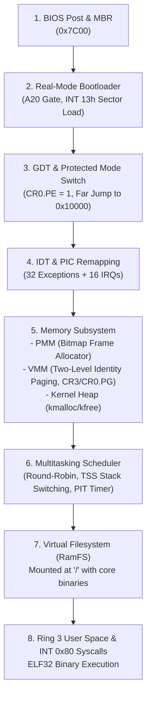

# ERAN OS
## Execution and Resource Administration Nucleus

An independent, 32-bit x86 Protected Mode operating system kernel written from scratch in freestanding C and NASM Assembly.

[]()
[-red?style=flat-square)]()
[](LICENSE)

---

### Architectural Overview

ERAN OS implements core operating system primitives directly on bare metal without standard C libraries (`-ffreestanding -nostdlib`):



---

### Subsystem Implementation Status

#### Core Subsystems (Fully Implemented & Verified in QEMU)
- **Two-Stage Bootloader (`boot/boot.asm`)**: Loaded at `0x7C00`, reads kernel sectors via BIOS INT 13h, enables the Fast A20 Gate, configures the initial GDT, and enters 32-bit Protected Mode.
- **Interrupt System (`kernel/idt.c`, `kernel/pic.c`)**: Remaps the dual 8259 PICs to vectors 32–47. Handles CPU exceptions (0–31) with register state dumps and page fault diagnostics (CR2).
- **Physical Memory Manager (`mm/pmm.c`)**: Manages 32MB physical memory using a 4KB-per-bit allocation bitmap.
- **Virtual Memory Manager (`mm/vmm.c`)**: Implements two-level paging (1024-entry Page Directory + Page Tables). Identity-maps the lower 16MB of physical RAM.
- **Kernel Heap (`mm/heap.c`)**: Provides dynamic kernel memory allocation (`kmalloc`, `kfree`) with 8-byte alignment and boundary guards.
- **Multitasking Scheduler (`process/process.c`)**: Preemptive round-robin scheduler driven by the 100Hz PIT timer. Switches context via stack frame preservation and updates TSS kernel stack pointers for Ring 3 transitions.
- **System Call Gate (`kernel/syscall.c`)**: `INT 0x80` interface providing unprivileged user tasks with kernel services (`SYS_YIELD`, `SYS_EXIT`, `SYS_WRITE`, `SYS_GETPID`).
- **Hardware Drivers**: PS/2 keyboard (scancode set 1), 8042 PS/2 mouse (streaming packet decoder), VGA text mode (80x25 double-buffered compositor), and PIT timer.

#### Experimental / Partial Subsystems
- **ATA Hard Disk Driver (`drivers/ata.c`)**: Polling-based PIO mode read/write driver for primary master ATA controllers.
- **Virtual Filesystem (`fs/vfs.c`)**: In-memory tree filesystem (RamFS) supporting `/bin`, `/etc`, and `/dev` mounts.
- **Networking Stack (`drivers/e1000.c`, `net/tcp.c`)**: Software-simulated network device interface; hardware DMA ring buffers and full socket state machine are in active development.

---

### Building and Running

#### Prerequisites
- `nasm` (x86 Assembler)
- `gcc` / `clang` (with 32-bit multilib support: `gcc-multilib`)
- `qemu-system-i386`
- `make`

#### Compilation & QEMU Emulation
```bash
# Clone the repository
git clone https://github.com/satyamk001-tech/Eran-OS.git
cd Eran-OS

# Build bootloader, kernel, and assemble floppy image
make clean
make all

# Launch in QEMU with serial console logging
qemu-system-i386 -fda build/eran_os.img -serial stdio
```

---

### Verification & Testing Harness

Automated verification tests run against QEMU serial output:

```bash
python3 tools/test_kernel.py
```

Covered test suites:
- **Boot Transition**: Verifies CPU mode flag and Protected Mode segment registers.
- **Memory Allocator (`memtest`)**: Validates page frame allocation, deallocation, and double-free rejection.
- **Scheduler (`schedtest`)**: Spawns concurrent tasks and verifies round-robin preemption and PID lifecycle.
- **Syscall Gate**: Executes Ring 3 user mode transitions and verifies `INT 0x80` dispatch.
