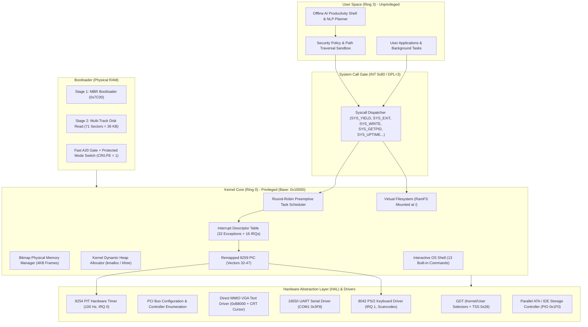

# Eran OS

<div align="center">

[](https://github.com/satyamk001-tech/Eran-OS)
[-orange?style=for-the-badge&logo=intel)](https://github.com/satyamk001-tech/Eran-OS)
[-red?style=for-the-badge)](https://github.com/satyamk001-tech/Eran-OS)
[](https://github.com/satyamk001-tech/Eran-OS)
[](https://github.com/satyamk001-tech/Eran-OS)
[](https://github.com/satyamk001-tech/Eran-OS)

**From Bare-Metal MBR Bootloader to a Hardware-Aware Kernel, Multitasking Operating System, and Integrated Offline AI Assistant.**

[Project Repository](https://github.com/satyamk001-tech/Eran-OS) • [Architecture Guide](docs/architecture.md) • [Boot Process](docs/boot-process.md) • [Roadmap](docs/roadmap.md) • [Hardware Matrix](docs/hardware-compatibility.md) • [AI Specification](docs/ai-architecture.md)

</div>

---

## 📖 Executive Summary & Core Vision

**Eran OS** is a custom operating system engineered from the ground up using low-level systems programming in C and x86 assembly. Beginning with a bare-metal Master Boot Record (MBR) bootloader, it progressively establishes processor control, initializes the Global Descriptor Table (GDT) and Interrupt Descriptor Table (IDT), configures hardware timers and device drivers, allocates physical memory frames and a dynamic kernel heap, enumerates PCI hardware controllers, mounts an in-memory Virtual Filesystem (VFS), runs an interactive shell with preemptive multitasking, and exposes validated system capabilities to an isolated, **offline AI productivity assistant**.

Eran OS is built as a **genuine operating system**, not a simulated web app or mock interface. Every subsystem is implemented directly in hardware-aware freestanding code, verified through automated emulator tests, and structured for long-term evolution toward physical computer hardware.

---

## 🏛️ System Architecture

Eran OS enforces a strict privilege separation boundary between privileged kernel services (Ring 0) and unprivileged user applications and the offline AI engine (Ring 3).



---

## ⚡ Implemented Subsystems & Features

### 1. Multi-Track Stage 1 & 2 MBR Bootloader (`boot/boot.asm`)
- **Execution Origin:** Physical address `0x7C00` in 16-bit real mode.
- **Segment Normalization:** Far jump `jmp 0x0000:init` guarantees `CS=0x0000`.
- **Direction Flag & Stack Setup:** `CLD` ensures string operations increment pointers; stack pointer initialized at `SP=0x7C00` growing safely downward into conventional memory.
- **Drive ID Preservation:** Captures BIOS boot drive index from register `DL`.
- **Multi-Track BIOS Disk Loading:** Overcomes floppy cylinder/head boundary constraints by performing track-aligned BIOS `INT 13h, AH=02h` reads across Track 0 Head 0, Track 0 Head 1, Track 1 Head 0, and Track 1 Head 1, reading **71 sectors (36 KB)** of kernel code directly into memory at physical address `0x10000`.
- **A20 Line Gate:** Asserts the Fast A20 gate via I/O port `0x92` to access memory beyond the 1 MB boundary.
- **GDT Configuration & Protected Mode Transition:** Populates 32-bit Global Descriptor Table with flat 4 GB Code and Data segment descriptors, asserts `CR0.PE = 1`, and executes a 32-bit far jump to flush the instruction queue into 32-bit Protected Mode.
- **Handover:** Sets 32-bit stack pointer at `0x90000` and transfers execution to the freestanding kernel at `0x10000`.

### 2. Freestanding 32-bit C & Assembly Kernel (`kernel/`)
- **Linker Script (`kernel/linker.ld`):** Links code (`.text`), read-only constants (`.rodata`), initialized data (`.data`), and uninitialized data (`.bss`) at physical load address `0x10000`.
- **Assembly Entry Stub (`kernel/entry.asm`):** Establishes segment registers (`0x10`), sets up the C stack frame, and calls `kmain()`.
- **Kernel Dispatcher (`kernel/kernel.c`):** Orchestrates sequential initialization of all subsystems, displays startup telemetry, mounts system storage, and launches the interactive event loop.

### 3. GDT with User Selectors & Task State Segment (TSS) (`kernel/gdt.c`)
- **Selectors:** Kernel Code (`0x08`), Kernel Data (`0x10`), User Code (`0x18`, DPL=3 -> `0x1B`), User Data (`0x20`, DPL=3 -> `0x23`), and Task State Segment (`0x28`).
- **Hardware Task Switching Support:** TSS loaded with `ltr ax`, providing the CPU with `TSS.ss0` and `TSS.esp0` to handle privilege transitions from Ring 3 to Ring 0 on interrupts and system calls.

### 4. Interrupts, Exceptions & Remapped PIC (`kernel/idt.c`, `kernel/pic.c`, `kernel/isr.asm`)
- **Interrupt Descriptor Table (IDT):** 256 interrupt gates configured.
- **CPU Exception Handlers (0–31):** Full exception reporting with structured register dumps (`EIP`, `CS`, `EFLAGS`, `EAX..EDI`, `ESP`), exception classification (Divide-by-Zero, Page Fault, GPF, Double Fault), and kernel panic containment.
- **8259 PIC Remapping:** Master and Slave PICs remapped from default vectors (`0x08-0x0F` which collide with CPU exceptions) to vectors `32-47`.

### 5. Hardware Timers & Calibration (`drivers/timer.c`)
- **8254 PIT (Programmable Interval Timer):** Configured on IRQ 0 at 100 Hz (10 ms per tick).
- **System Uptime & Delay:** Tracks elapsed seconds and hardware ticks, providing calibrated `sleep_ticks()` and `sleep_ms()` routines.
- **Scheduler Integration:** Invokes `process_schedule()` on every timer tick to drive preemptive task switching.

### 6. PS/2 Keyboard Controller (`drivers/keyboard.c`)
- **IRQ 1 Driver:** Reads scancodes from port `0x60`.
- **Scancode Set 1 Translation:** Decodes ASCII characters with support for Left/Right Shift states, Caps Lock toggle, and navigation keys.
- **Ring Buffer:** Thread-safe circular keystroke buffer supporting non-blocking `keyboard_getc()` and blocking `keyboard_getchar()`.

### 7. Direct MMIO VGA Video Driver (`drivers/vga.c`)
- **Direct Video Memory:** Writes directly to the VGA text mode buffer at physical address `0xB8000`.
- **Color Attributes & Scrolling:** Supports 16 foreground and 16 background colors with automatic line scrolling at row 25.
- **CRT Cursor Controller:** Updates the blinking hardware cursor position via CRT controller ports `0x3D4` and `0x3D5`.
- **Formatted `kprintf`:** Custom printf implementation supporting `%s`, `%c`, `%d`, `%i`, `%u`, `%x`, `%X`, `%p`, and `%%`.

### 8. 16550 UART Serial Driver (`drivers/serial.c`)
- **Port I/O COM1:** Configured at base I/O port `0x3F8`.
- **Configuration:** 38,400 baud rate, 8 data bits, no parity, 1 stop bit (8N1), 14-byte FIFO buffer enabled.
- **Dual-Channel Output:** All kernel messages and shell logs are streamed simultaneously to screen and serial, enabling automated headless testing.

### 9. Memory Management Subsystems (`mm/`)
- **Physical Memory Manager (`mm/pmm.c`):** Bitmap page frame allocator managing 4KB physical pages across 32 MB of RAM. Low memory (0x000000–0x1FFFFF) is protected, leaving 30 MB+ of physical frames for allocation via `pmm_alloc_page()` and `pmm_free_page()`.
- **Kernel Dynamic Heap (`mm/heap.c`):** Linked-list boundary-tag heap allocator placed at `0x200000` (2 MB) with 4 MB of dynamic memory, implementing `kmalloc()`, `kfree()`, block splitting, and adjacent free block coalescing.

### 10. Hardware Abstraction Layer & PCI Bus Enumeration (`hal/`)
- **Port I/O (`hal/io.h`):** Inline assembly primitives (`inb`, `outb`, `inw`, `outw`, `inl`, `outl`, `io_wait`).
- **PCI Enumeration (`hal/pci.c`):** Scans PCI configuration space (ports `0xCF8` and `0xCFC`), identifying vendor IDs, device IDs, and class codes for Host Bridges, VGA Display Controllers, IDE/SATA Storage Controllers, and Ethernet Network Adapters.

### 11. Parallel ATA / IDE Storage Controller (`drivers/ata.c`)
- **Primary Bus PIO Mode:** Probes ports `0x1F0`–`0x1F7` via `IDENTIFY` (0xEC).
- **Sector Operations:** Programmed I/O read and write functions with timeout-guarded status polling (`BSY`, `DRQ`, `ERR`), cache flushing (`0xE7`), and capacity diagnostics.

### 12. Virtual Filesystem (VFS) & RamFS (`fs/vfs.c`)
- **VFS Node Tree:** Filesystem abstraction supporting file and directory nodes.
- **In-Memory RamFS:** Root directory `/` populated at boot with `/README.txt`, `/system/os_info.txt`, `/etc/hostname`, and `/devices.txt`.
- **Operations:** Directory listing (`vfs_list_dir`) and file content reading (`vfs_read_file`).

### 13. Preemptive Multitasking Process Scheduler (`process/process.c`)
- **Process Control Blocks (PCB):** Tracks PID, process name, execution state (`READY`, `RUNNING`, `BLOCKED`, `TERMINATED`), saved stack pointer (`ESP`), and CPU ticks.
- **Context Switcher:** Round-robin scheduler switching task contexts on timer ticks and cooperative `process_yield()`.
- **Active Tasks:** Concurrently runs `kernel_main` (PID 0) and background monitor `bg_monitor` (PID 1).

### 14. System Call Interface (`kernel/syscall.c`)
- **Software Interrupt `INT 0x80`:** Configured with DPL=3 flags (`0xEE`) for unprivileged Ring 3 accessibility.
- **Syscall Dispatcher:** Implements `SYS_YIELD` (0), `SYS_EXIT` (1), `SYS_WRITE` (2), `SYS_READ` (3), `SYS_GETPID` (4), `SYS_UPTIME` (5), and `SYS_DEVINFO` (6).

### 15. Interactive Operating System Shell (`kernel/shell.c`)
- **Unified Input Multiplexer:** Reads commands from both the physical/virtual PS/2 keyboard and the UART COM1 serial receiver.
- **Built-In Commands:**
  - `help` — List all supported commands.
  - `version` — Show kernel build and architecture details.
  - `clear` — Clear the VGA text console.
  - `cpuinfo` — Display CR0, EFLAGS, and segment register selectors.
  - `meminfo` — Display physical frame allocations and kernel heap usage.
  - `uptime` — Display system uptime from the 100 Hz timer.
  - `processes` — Enumerate active tasks and scheduler state.
  - `devices` — Enumerate all detected PCI hardware controllers.
  - `atainfo` — Display Parallel ATA / IDE storage status and capacity.
  - `syscall` — Test `INT 0x80` system call dispatch.
  - `ls [path]` — List files and directories from the VFS.
  - `cat <path>` — Display text file contents.
  - `echo <text>` — Print text to console and serial log.
  - `reboot` — Perform warm hardware reboot via 8042 keyboard controller.
  - `shutdown` — Power off the system via ACPI / QEMU ports.
  - `panic` — Trigger an intentional divide-by-zero exception to test fault containment.

### 16. Offline AI Productivity Assistant & Sandboxed Shell (`ai-shell/`)
- **Privilege Separation:** Operates entirely in unprivileged user space (Ring 3 / Host environment) without direct access to privileged kernel memory or hardware registers.
- **Natural Language Intent Classifier (`intent.py`):** Automatically maps user queries into categorized intents: file discovery, document reading, hardware query, system status, and settings configuration.
- **Structured Action Planning (`planner.py`):** Translates intents into strongly-typed action schemas (`FindFiles`, `ReadFile`, `QueryDevices`, `GetSystemInfo`), preventing arbitrary code or shell injection attacks.
- **Security Policy Engine (`policy.py`):** Validates all proposed actions against strict sandbox boundaries, canonicalizing paths and blocking directory traversal (`../`) attacks.
- **Confirmation Guards:** Destructive operations (`delete`, overwrite) require explicit interactive confirmation.
- **Modular Offline Providers (`providers/`):** 100% offline deterministic rule-based NLP provider with adapter hooks for local quantized language models (`llama.cpp` / GGUF).

---

## 📁 Repository Directory Layout

```
eran-os/
├── Makefile                          # Master build system
├── README.md                         # Complete project documentation
├── .gitignore                        # Git ignore rules for build and cache artifacts
├── boot/
│   └── boot.asm                      # Stage 1 MBR & Stage 2 protected mode switch (71 sectors)
├── kernel/
│   ├── entry.asm                     # 32-bit kernel entry point
│   ├── kernel.c                      # Kernel main dispatcher & subsystem orchestration
│   ├── isr.asm                       # CPU exception & IRQ low-level assembly stubs
│   ├── gdt.h / gdt.c                 # GDT with User Selectors & TSS 0x28
│   ├── idt.h / idt.c                 # Interrupt Descriptor Table & exception handlers
│   ├── pic.h / pic.c                 # 8259 PIC remapping and EOI dispatch
│   ├── syscall.h / syscall.c         # System Call Interface (INT 0x80, DPL=3)
│   ├── shell.h / shell.c             # Interactive OS Shell (multiplexed input)
│   └── linker.ld                     # Kernel linker script (0x10000 physical)
├── process/
│   ├── process.h / process.c         # PCB, stack frames, round-robin scheduler
├── hal/
│   ├── io.h                          # Port I/O hardware abstraction primitives
│   └── pci.h / pci.c                 # PCI bus scanner & device enumeration
├── drivers/
│   ├── vga.h / vga.c                 # Direct MMIO VGA text driver & kprintf
│   ├── serial.h / serial.c           # 16550 UART serial driver (COM1 0x3F8)
│   ├── timer.h / timer.c             # 8254 PIT hardware timer (100 Hz, IRQ 0)
│   ├── keyboard.h / keyboard.c       # 8042 PS/2 keyboard driver (IRQ 1)
│   └── ata.h / ata.c                 # Parallel ATA / IDE storage driver (PIO mode)
├── mm/
│   ├── pmm.h / pmm.c                 # Bitmap Physical Memory Manager (4KB frames)
│   └── heap.h / heap.c               # Dynamic Kernel Heap (kmalloc / kfree)
├── fs/
│   └── vfs.h / vfs.c                 # Virtual Filesystem & RamFS mount
├── tools/
│   ├── test_boot.py                  # Automated QEMU kernel regression test suite
│   └── test_ai.py                    # Offline AI Shell test runner
├── ai-shell/
│   ├── pyproject.toml                # AI Shell project metadata
│   ├── src/eran_shell/
│   │   ├── main.py                   # AI Shell CLI and interactive REPL
│   │   ├── interface.py              # Visual formatting and prompt interface
│   │   ├── intent.py                 # Intent classification engine
│   │   ├── planner.py                # Strongly-typed structured action schemas
│   │   ├── policy.py                 # Security policy & path traversal sandbox
│   │   ├── executor.py               # Sandboxed action executor
│   │   └── providers/
│   │       ├── base.py               # Abstract model provider interface
│   │       ├── rule_based.py         # Deterministic offline NLP provider
│   │       └── local_llm.py          # Local quantized model provider adapter
│   └── tests/
│       └── test_ai_shell.py          # Automated security & unit test suite
└── docs/
    ├── architecture.md               # Detailed system architecture specification
    ├── boot-process.md               # Memory layout & protected mode boot sequence
    ├── roadmap.md                    # Multi-phase roadmap (Phases 0–20)
    ├── hardware-compatibility.md     # Verified hardware matrix
    └── ai-architecture.md            # Offline AI Assistant & security design
```

---

## 🚀 Getting Started

### Prerequisites

On Ubuntu Linux (or Debian-based systems), install the standard build toolchain and QEMU emulator:

```bash
sudo apt update
sudo apt install -y nasm gcc build-essential qemu-system-x86 python3 git
```

### Cloning the Repository

```bash
git clone https://github.com/satyamk001-tech/Eran-OS.git
cd Eran-OS
```

### Building the Operating System

To assemble the bootloader, compile all kernel modules, and generate the bootable 1.44 MB disk image (`build/eran_os.img`):

```bash
make clean && make all
```

---

## 🖥️ Running Eran OS in QEMU

Eran OS supports three execution modes:

### 1. Graphical VGA Window Mode
Launches Eran OS with a full 80x25 VGA graphical display and interactive PS/2 keyboard support:
```bash
make run
```

### 2. Headless CLI Mode (Serial on stdio)
Runs Eran OS headlessly in your terminal with COM1 serial redirected to standard I/O:
```bash
make run-cli
```

### 3. Remote GDB Debugging Mode
Launches QEMU in a paused state, exposing a GDB remote stub on `localhost:1234`:
```bash
make debug
```
Connect using GDB in another terminal:
```bash
gdb -ex "target remote localhost:1234" -ex "symbol-file build/kernel.o"
```

---

## 🧪 Automated Verification Test Suites

Eran OS includes fully automated regression test suites:

### Kernel & Subsystem Verification (`make test`)
Boots the disk image in headless QEMU, verifies binary geometry, validates MBR signatures, and asserts output from every initialized kernel subsystem:
```bash
$ make test
=================================================================
  Eran OS - Comprehensive Automated Kernel Verification Suite
=================================================================
[TEST] Verifying bootloader and kernel binaries...
[PASS] Boot sector = 512 bytes (MBR verified). Kernel binary = 32776 bytes.
[PASS] Disk image = 1474560 bytes (1.44MB standard geometry verified).
[TEST] Running Eran OS kernel in QEMU (headless, serial=file)...
[PASS] Matched subsystem: 'Eran OS Bootloader v0.2.0'
[PASS] Matched subsystem: '[BOOT] Tracks 0-1 loaded. Total 71 sectors (36 KB).'
[PASS] Matched subsystem: 'ERAN OS - KERNEL v0.2.0'
[PASS] Matched subsystem: 'Target: x86 32-bit Protected Mode (Base: 0x10000)'
[PASS] Matched subsystem: 'GDT active (Kernel/User Ring 0/3 segments + TSS 0x28).'
[PASS] Matched subsystem: 'IDT active (32 CPU Exceptions + 16 IRQs remapped).'
[PASS] Matched subsystem: 'Initializing 8254 PIT Timer (100 Hz)...'
[PASS] Matched subsystem: 'Initializing PS/2 Keyboard Driver (IRQ 1)...'
[PASS] Matched subsystem: 'Hardware interrupts globally enabled.'
[PASS] Matched subsystem: 'PMM initialized.'
[PASS] Matched subsystem: 'Kernel Heap initialized'
[PASS] Matched subsystem: 'System call dispatcher active (SYS_YIELD, SYS_EXIT, SYS_WRITE...).'
[PASS] Matched subsystem: 'Multitasking scheduler active (PID 0: kernel_main, PID 1: bg_monitor).'
[PASS] Matched subsystem: 'Scanning PCI Bus for hardware controllers...'
[PASS] Matched subsystem: 'Primary ATA controller initialized'
[PASS] Matched subsystem: 'VFS root '/' mounted with initial system files.'
[PASS] Matched subsystem: '[STATUS] Eran OS kernel initialization completed successfully!'
[PASS] Matched subsystem: 'eran>'
=================================================================
[RESULT] ALL OPERATING SYSTEM SUBSYSTEM TESTS PASSED.
=================================================================
```

### AI Shell & Sandbox Security Tests (`make test-ai`)
Executes unit tests validating intent classification, structured action schemas, and security policy sandboxing:
```bash
$ make test-ai
=================================================================
  Eran OS - Offline AI Shell & Policy Test Suite
=================================================================
Ran 7 tests in 0.001s
OK
=================================================================
[RESULT] ALL AI SHELL TESTS PASSED.
=================================================================
```

---

## 🤖 Running the Offline AI Assistant

You can launch the interactive AI Shell directly:

```bash
make run-ai
```

Or execute single natural language queries from your terminal:

```bash
# Query connected hardware devices
python3 ai-shell/src/eran_shell/main.py -c "show connected devices"

# Find specific kernel files
python3 ai-shell/src/eran_shell/main.py -c "find files named boot.asm"

# Read documentation safely
python3 ai-shell/src/eran_shell/main.py -c "read file README.md"

# Test sandbox security (path traversal is blocked)
python3 ai-shell/src/eran_shell/main.py -c "read file ../../../etc/shadow"
```

---

## 📊 Hardware Verification Matrix

| Subsystem | Hardware Controller | Interface | Verification Status |
|:---|:---|:---|:---:|
| **CPU Architecture** | x86 (IA-32) Compatible | 16-bit Real Mode / 32-bit Protected Mode | **Verified** |
| **Descriptor Tables** | GDT (Kernel/User) & IDT | Flat 4GB Segments + TSS (0x28) + 256 Gates | **Verified** |
| **Interrupt Controller** | Dual Intel 8259 PIC | Port I/O `0x20`/`0x21` & `0xA0`/`0xA1` (Remapped 32-47) | **Verified** |
| **Hardware Timer** | Intel 8254 PIT | IRQ 0 @ 100 Hz (Port `0x40`/`0x43`) | **Verified** |
| **Keyboard** | Standard 8042 PS/2 | Port `0x60` / IRQ 1 (Scancode Set 1, Shift/Caps) | **Verified** |
| **Video Console** | VGA Direct Memory | MMIO `0xB8000` (80x25 Text Mode, CRT Cursor `0x3D4`) | **Verified** |
| **Serial Console** | 16550 UART (COM1) | Port I/O `0x3F8` (38400 baud, 8N1, FIFO enabled) | **Verified** |
| **Physical Memory** | Bitmap Page Allocator | 4KB Page Frames across 32 MB Physical RAM | **Verified** |
| **Kernel Heap** | Dynamic Linked-List Heap | `kmalloc()` / `kfree()` across 4 MB Heap (`0x200000`) | **Verified** |
| **System Calls** | Software Interrupt `INT 0x80` | IDT Gate 128 (DPL=3, Ring 3 unprivileged) | **Verified** |
| **Multitasking** | Round-Robin Scheduler | Cooperative & Preemptive Task Switching (`process_t`) | **Verified** |
| **Bus Enumeration** | PCI Configuration Space | Ports `0xCF8` / `0xCFC` (Vendor/Device/Class decoding) | **Verified** |
| **Storage Controller** | Parallel ATA / IDE | Primary Master PIO Mode (`0x1F0`–`0x1F7`) | **Verified** |
| **Filesystem** | Virtual Filesystem (VFS) | In-Memory RamFS (`/README.txt`, `/system/`, `/etc/`) | **Verified** |
| **AI Assistant** | Sandboxed AI Shell | Offline NLP Planner & Path Traversal Guard | **Verified** |

---

## 🗺️ Multi-Phase Implementation Roadmap

- [x] **Phase 0:** Repository & Toolchain Baseline Audit
- [x] **Phase 1:** Stage 1 MBR Bootloader Stabilization & COM1 Serial Logging
- [x] **Phase 2:** Multi-Track Sector Loading, Fast A20, 32-bit GDT & Protected Mode Switch
- [x] **Phase 3:** Freestanding C Kernel at `0x10000` & Direct MMIO VGA Text Driver
- [x] **Phase 4:** IDT Exception Handling (0–31), 8259 PIC Remapping & PIT 100 Hz Timer
- [x] **Phase 5:** Bitmap Physical Memory Manager (PMM) & Dynamic Kernel Heap (`kmalloc`/`kfree`)
- [x] **Phase 6:** PS/2 Keyboard Driver (IRQ 1) & Interactive Kernel Console
- [x] **Phase 7:** Hardware Abstraction Layer (HAL) & PCI Bus Controller Discovery
- [x] **Phase 8:** Virtual Filesystem (VFS), RamFS Mount & Parallel ATA / IDE Storage Driver
- [x] **Phase 10:** Process Management, Round-Robin Preemptive Scheduler, TSS & System Calls (`INT 0x80`)
- [x] **Phase 15:** Unprivileged Host-Side AI Shell Prototype & Structured Action Planning
- [x] **Phase 16:** 100% Offline NLP Provider & Sandboxed Policy Enforcement
- [x] **Phase 19:** Path Traversal Sandbox Enforcement & Destructive Action Guards
- [ ] **Phase 5c:** Two-Level Virtual Memory Paging (`CR3`, Page Directories & Tables)
- [ ] **Phase 9:** USB Subsystem (UHCI/EHCI Host Controller & USB HID Drivers)
- [ ] **Phase 11:** Gigabit Ethernet Network Stack (Intel e1000 Driver, ARP, IPv4, TCP/UDP)
- [ ] **Phase 12:** Audio Subsystem (Intel High Definition Audio / AC97 Codecs)
- [ ] **Phase 13:** VBE Linear Framebuffer Graphical Desktop & Window Compositor
- [ ] **Phase 14:** ACPI Power Management, Battery & Thermal Monitoring
- [ ] **Phase 17:** Offline Speech-to-Text & Spoken Voice Assistant Integration
- [ ] **Phase 18:** Native C Ring 3 Userland Port of the AI Productivity Engine
- [ ] **Phase 20:** Physical Bare-Metal PC Testing & x86_64 / UEFI Long Mode Handover

---

## 📄 License & Attribution

Eran OS is an open-source operating system project developed under the **MIT License**.
All architectural concepts, low-level drivers, and AI safety mechanisms are documented for educational and systems research purposes.

🔗 **GitHub Project Repository:** [https://github.com/satyamk001-tech/Eran-OS](https://github.com/satyamk001-tech/Eran-OS)
