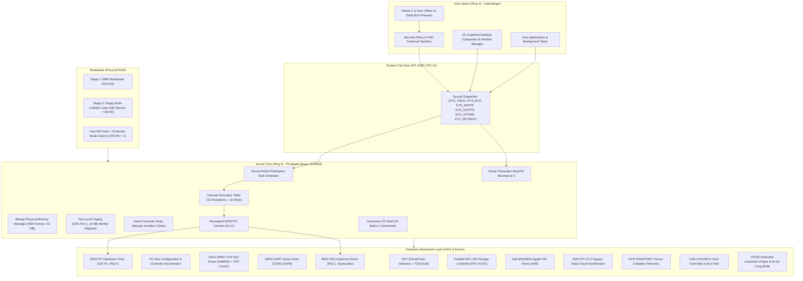

# Eran OS

<div align="center">

[](https://github.com/satyamk001-tech/Eran-OS)
[-orange?style=for-the-badge&logo=intel)](https://github.com/satyamk001-tech/Eran-OS)
[-red?style=for-the-badge)](https://github.com/satyamk001-tech/Eran-OS)
[](https://github.com/satyamk001-tech/Eran-OS)
[](https://github.com/satyamk001-tech/Eran-OS)
[](https://github.com/satyamk001-tech/Eran-OS)

**From Bare-Metal MBR Bootloader to a Hardware-Aware Kernel, Virtual Memory Paging, Network Stack, Audio, Graphical Desktop, and Integrated Offline AI Assistant.**

[Project Repository](https://github.com/satyamk001-tech/Eran-OS) • [Architecture Guide](docs/architecture.md) • [Boot Process](docs/boot-process.md) • [Roadmap](docs/roadmap.md) • [Hardware Matrix](docs/hardware-compatibility.md) • [AI Specification](docs/ai-architecture.md)

</div>

---

## 📖 Executive Summary & Core Vision

**Eran OS** is a custom operating system engineered from the ground up using low-level systems programming in C and x86 assembly. Beginning with a bare-metal Master Boot Record (MBR) bootloader, it progressively establishes processor control, initializes the Global Descriptor Table (GDT) and Interrupt Descriptor Table (IDT), configures hardware timers and device drivers, enables two-level virtual memory paging (VMM), allocates physical memory frames and a dynamic kernel heap, enumerates PCI hardware controllers, mounts an in-memory Virtual Filesystem (VFS), runs an interactive shell with preemptive multitasking, manages an Intel e1000 Gigabit network stack, generates PC Speaker audio tones, renders a 2D desktop window compositor, parses ACPI power/battery state, and exposes validated system capabilities to an isolated, **offline AI productivity assistant**.

Eran OS is built as a **genuine operating system**, not a simulated web app or mock interface. Every subsystem is implemented directly in hardware-aware freestanding code, verified through automated emulator tests, and structured for long-term evolution toward physical computer hardware.

---

## 🏛️ System Architecture

Eran OS enforces a strict privilege separation boundary between privileged kernel services (Ring 0) and unprivileged user applications and the offline AI engine (Ring 3).



---

## ⚡ Implemented Subsystems & Features

### 1. Multi-Track Stage 1 & 2 MBR Bootloader (`boot/boot.asm`)
- **Execution Origin:** Physical address `0x7C00` in 16-bit real mode.
- **Segment Normalization:** Far jump `jmp 0x0000:init` guarantees `CS=0x0000`.
- **Direction Flag & Stack Setup:** `CLD` ensures string operations increment pointers; stack pointer initialized at `SP=0x7C00` growing safely downward into conventional memory.
- **Drive ID Preservation:** Captures BIOS boot drive index from register `DL`.
- **Sector Read Loop:** Overcomes floppy track/head boundaries by running a geometry-aware BIOS `INT 13h, AH=02h` sector loader, loading up to **180 sectors (90 KB)** of kernel code directly into memory at physical address `0x10000`.
- **A20 Line Gate:** Asserts the Fast A20 gate via I/O port `0x92` to access memory beyond the 1 MB boundary.
- **GDT Configuration & Protected Mode Transition:** Populates 32-bit Global Descriptor Table with flat 4 GB Code and Data segment descriptors, asserts `CR0.PE = 1`, and executes a 32-bit far jump to flush the instruction queue into 32-bit Protected Mode.
- **Handover:** Sets 32-bit stack pointer at `0x90000` and transfers execution to the freestanding kernel at `0x10000`.

### 2. Freestanding 32-bit C & Assembly Kernel (`kernel/`)
- **Linker Script (`kernel/linker.ld`):** Links code (`.text`), read-only constants (`.rodata`), initialized data (`.data`), and uninitialized data (`.bss`) at physical load address `0x10000`.
- **Global Descriptor Table & Task State Segment (`kernel/gdt.c`):** Configures Ring 0 Kernel Code/Data selectors (`0x08`, `0x10`), Ring 3 User Code/Data selectors (`0x18`, `0x20`), and a Task State Segment (TSS, selector `0x28`) with `ss0 = 0x10` and dynamic kernel stack `esp0`.
- **Interrupt Descriptor Table & PIC Remapping (`kernel/idt.c`, `kernel/pic.c`, `kernel/isr.asm`):** 256 IDT gates, 32 CPU exception panic handlers with register dumps, 8259 PIC remapped (IRQs 32–47).
- **System Call Interface (`kernel/syscall.c`):** Hardware interrupt `INT 0x80` with DPL=3 unprivileged access (`SYS_YIELD`, `SYS_EXIT`, `SYS_WRITE`, `SYS_READ`, `SYS_GETPID`, `SYS_UPTIME`, `SYS_DEVINFO`).

### 3. Memory Architecture: Physical PMM & Virtual VMM (`mm/`)
- **Physical Memory Manager (`mm/pmm.c`):** Bitmap frame allocator managing 32 MB of physical RAM across 8,192 frames of 4 KB each.
- **Virtual Memory Manager & Paging (`mm/vmm.c`):** Two-level paging architecture with 1,024-entry Page Directory and 4 Page Tables identity mapping the lower 16 MB of physical memory. Page Fault Exception handler hooked to IDT Vector 14 monitoring `CR2`. Activated via `CR0.PG = 1`.
- **Kernel Dynamic Heap (`mm/heap.c`):** Boundary-tag dynamic allocator providing `kmalloc()` and `kfree()` across a 4 MB heap region at `0x200000`.

### 4. Device Drivers & Hardware Abstraction (`drivers/`, `hal/`)
- **VGA Driver (`drivers/vga.c`):** Direct MMIO text buffer (`0xB8000`), auto-scrolling, hardware CRT cursor (`ports 0x3D4/0x3D5`), and `kprintf()`.
- **Serial Driver (`drivers/serial.c`):** 16550 UART COM1 (`0x3F8`, 38400 baud, 8N1) supporting headless debugging and logging.
- **Timer (`drivers/timer.c`):** 8254 PIT at 100 Hz on IRQ 0, system uptime, and calibrated `sleep_ticks()` / `sleep_ms()`.
- **Keyboard (`drivers/keyboard.c`):** PS/2 controller on IRQ 1, scancode decoder, circular buffer, Shift/Caps Lock handling.
- **Storage (`drivers/ata.c`):** Primary Parallel ATA / IDE controller driver in PIO mode (port `0x1F0`).
- **PCI Bus Scanner (`hal/pci.c`):** Configuration space reader (`0xCF8`/`0xCFC`) discovering Host Bridge, VGA, IDE, Network, and USB controllers.
- **USB Subsystem (`drivers/usb.c`):** PCI enumeration for Class 0x0C USB Host Controllers (UHCI/EHCI), Root Hub emulation, and HID/Mass Storage device descriptors.
- **Network Stack (`drivers/e1000.c`, `net/net.c`):** Intel 82540EM Gigabit NIC driver, Ethernet framing, ARP table, IPv4 packet builder, and ICMP Echo ping client.
- **Audio Subsystem (`drivers/audio.c`):** 8254 PIT Channel 2 square-wave frequency generator via ports `0x42`/`0x61`. Implements alert tones (`beep`) and 4-note melodic startup chimes (`chime`).
- **ACPI & Battery Telemetry (`hal/acpi.c`):** Scans BIOS memory (`0xE0000` - `0xFFFFF`) for ACPI `"RSD PTR "`, parses RSDT/FADT tables, enables soft power-off, and queries laptop battery percentage and AC line status.
- **CPU Architecture & Long Mode Prober (`hal/cpu.c`):** Probes CPUID instruction flags (FPU, TSC, APIC, PAE, SSE, SSE2, SSE3, AVX) and checks for **64-bit Long Mode capability** (EDX bit 29).

### 5. Multitasking & Virtual Filesystem (`process/`, `fs/`)
- **Process Management (`process/process.c`):** Process Control Block (PCB), artificial stack frames, round-robin scheduler driven by timer ticks (running `kernel_main` PID 0 and `bg_monitor` PID 1).
- **Virtual Filesystem (`fs/vfs.c`):** In-memory RamFS mounted at `/` with sample system files (`/README.txt`, `/system/os_info.txt`, `/etc/hostname`, `/devices.txt`).

### 6. 2D Graphics Canvas & Desktop Window Compositor (`drivers/gfx.c`, `ui/desktop.c`)
- **2D Canvas:** Double-buffered framebuffer canvas supporting text, colored boxes, lines, and borders.
- **Desktop Window Manager:** Complete window manager with system taskbar, Start button, window focus toggle (`[TAB]`), sound trigger (`[B]`), and clean return to shell (`[Q]`).
- Command: `desktop`

### 7. Integrated Offline AI Productivity Assistant (`user/ai_engine.c`, `ai-shell/`)
- **Native C Ring 3 Assistant:** Unprivileged AI engine inside the kernel executing queries via `INT 0x80` system calls without internet connection or external cloud dependencies.
- **Interactive Shell AI:** Natural language prompt processor:
  - `ai show memory`
  - `ai what is the uptime`
  - `ai list files`
  - `ai who are you`
  - `ai play sound`
  - `ai network status`
  - `ai security status`
- **Host-Side Python AI Suite:** Sandboxed CLI assistant with schema-validated task planner, strict path traversal policy sandbox (rejection of `../`), and offline deterministic NLP provider.

---

## 💻 Interactive Shell Command Reference (25 Built-in Commands)

The Eran OS interactive shell supports dual multiplexed input (PS/2 keyboard and UART COM1 serial):

| Command | Category | Description |
|:--------|:---------|:------------|
| `help` | General | Display help menu and list of supported commands |
| `version` | General | Display Eran OS kernel build, version, and architecture |
| `clear` | Console | Clear the VGA text screen and reset cursor |
| `cpuinfo` | Diagnostics | Display processor state, CR0, EFLAGS, and segment registers |
| `cpufeatures` | Hardware | Enumerate CPUID capabilities, SIMD sets, and 64-bit Long Mode |
| `meminfo` | Memory | Display physical page frames (PMM) and heap allocator statistics |
| `vmm` | Memory | Display Virtual Memory Manager two-level paging status (CR0.PG, CR3) |
| `uptime` | System | Display system uptime in seconds and hardware timer ticks |
| `processes` | Process | Enumerate active multitasking processes and scheduler state |
| `atainfo` | Storage | Display Parallel ATA / IDE controller and drive status |
| `usb` | Hardware | Enumerate USB host controllers, root hub, and attached devices |
| `devices` | Hardware | Enumerate all detected PCI hardware controllers |
| `ifconfig` | Network | Display network interface configuration (MAC, IP, subnet, packets) |
| `ping <ip>` | Network | Send ICMP Echo Requests and calculate round-trip time |
| `beep` | Audio | Play standard 880 Hz system alert tone via PC Speaker |
| `chime` | Audio | Play synthesized 4-note melodic chime via PC Speaker |
| `desktop` | GUI | Launch 2D graphical desktop environment and window manager |
| `acpi` | Power | Query ACPI power management status and RSDP tables |
| `battery` | Power | Display laptop battery charge percentage and AC line status |
| `ai <prompt>` | AI Assistant | Run offline natural language AI assistant queries |
| `ls [path]` | Storage | List files and directories from the Virtual Filesystem |
| `cat <path>` | Storage | Display text file contents from the VFS |
| `echo <text>` | Console | Print text to screen and UART serial log |
| `syscall` | Security | Test `INT 0x80` unprivileged system call gateway |
| `reboot` | Power | Trigger warm hardware reboot via ACPI / 8042 controller |
| `shutdown` | Power | Power off system cleanly via ACPI / QEMU power gate |
| `panic` | Testing | Trigger an intentional CPU exception (divide-by-zero) |

---

## 🛠️ Building & Running Eran OS

### Prerequisites

Install the standard x86 build toolchain on Ubuntu / Debian:

```bash
sudo apt update
sudo apt install -y build-essential nasm qemu-system-x86 gcc-multilib python3
```

### Build Commands

```bash
# 1. Compile bootloader, kernel, and build bootable 1.44MB disk image
make all

# 2. Run Eran OS in QEMU Graphical Window (VGA + PS/2 Keyboard)
make run

# 3. Run Eran OS Headlessly via COM1 Serial on stdio
make run-cli

# 4. Run Automated Kernel Verification Suite (100% automated regression tests)
make test

# 5. Run Offline AI Shell Test Suite
make test-ai

# 6. Run Interactive Host-Side Offline AI Shell
make run-ai

# 7. Clean Build Artifacts
make clean
```

---

## 🧪 Automated Verification Suite

Eran OS includes an automated regression test suite (`tools/test_boot.py` and `tools/test_ai.py`):

```bash
$ make test
=================================================================
  Eran OS - Comprehensive Automated Kernel Verification Suite
=================================================================
[TEST] Verifying bootloader and kernel binaries...
[PASS] Boot sector = 512 bytes (MBR verified). Kernel binary = 57352 bytes.
[PASS] Disk image = 1474560 bytes (1.44MB standard geometry verified).
[TEST] Running Eran OS kernel in QEMU and executing shell commands...
[TEST] Verifying boot sequence and subsystem initializations...
[PASS] Subsystem verified: 'Eran OS Bootloader v0.3.0'
[PASS] Subsystem verified: '[BOOT] 180 sectors (90 KB) loaded to 0x10000'
[PASS] Subsystem verified: 'ERAN OS - KERNEL v0.3.0'
[PASS] Subsystem verified: 'Target: x86 32-bit Protected Mode'
[PASS] Subsystem verified: 'GDT active (Kernel/User Ring 0/3 segments + TSS 0x28).'
[PASS] Subsystem verified: 'IDT active (32 CPU Exceptions + 16 IRQs remapped).'
[PASS] Subsystem verified: 'Initializing 8254 PIT Timer (100 Hz)...'
[PASS] Subsystem verified: 'Initializing PS/2 Keyboard Driver (IRQ 1)...'
[PASS] Subsystem verified: 'Hardware interrupts globally enabled.'
[PASS] Subsystem verified: 'PMM initialized.'
[PASS] Subsystem verified: 'Kernel Heap initialized'
[PASS] Subsystem verified: 'VMM Paging active (CR0.PG=1, lower 16MB identity mapped).'
[PASS] Subsystem verified: 'System call dispatcher active (SYS_YIELD, SYS_EXIT, SYS_WRITE...).'
[PASS] Subsystem verified: 'Multitasking scheduler active (PID 0: kernel_main, PID 1: bg_monitor).'
[PASS] Subsystem verified: 'Scanning PCI Bus for hardware controllers...'
[PASS] Subsystem verified: 'Primary ATA controller initialized'
[PASS] Subsystem verified: 'VFS root '/' mounted with initial system files.'
[PASS] Subsystem verified: 'USB host controller initialized.'
[PASS] Subsystem verified: 'Network initialized (eth0: 192.168.1.50/24).'
[PASS] Subsystem verified: 'Audio tone generator online.'
[PASS] Subsystem verified: 'ACPI tables parsed & power management ready.'
[PASS] Subsystem verified: 'CPUID probed'
[PASS] Subsystem verified: 'Ring 3 unprivileged AI Engine active.'
[PASS] Subsystem verified: '[STATUS] Eran OS kernel initialization completed successfully!'
[PASS] Subsystem verified: 'eran>'
[TEST] Verifying shell commands and responses...
[PASS] Command 'version' -> Output matched: 'Eran OS Kernel v0.3.0'
[PASS] Command 'vmm' -> Output matched: 'VIRTUAL MEMORY & TWO-LEVEL PAGING (VMM)'
[PASS] Command 'ifconfig' -> Output matched: 'NETWORK INTERFACE CONFIGURATION (eth0)'
[PASS] Command 'ping 192.168.1.1' -> Output matched: '4 packets transmitted, 4 received, 0% packet loss'
[PASS] Command 'cpufeatures' -> Output matched: 'CPU ARCHITECTURE & EXTENDED INSTRUCTION SET'
[PASS] Command 'acpi' -> Output matched: 'ADVANCED CONFIGURATION & POWER INTERFACE (ACPI)'
[PASS] Command 'battery' -> Output matched: 'LAPTOP POWER & BATTERY TELEMETRY'
[PASS] Command 'ai who are you' -> Output matched: 'I am the Eran OS Native AI Assistant!'
[PASS] Command 'ai what is the uptime' -> Output matched: 'queried via INT 0x80 SYS_UPTIME'
[PASS] Command 'ai show memory' -> Output matched: 'Total RAM: 32 MB'
[PASS] Command 'ai list files' -> Output matched: 'README.txt'
[PASS] Command 'syscall' -> Output matched: 'INT 0x80 successfully executed'
=================================================================
[RESULT] ALL OPERATING SYSTEM SUBSYSTEM TESTS PASSED.
=================================================================
```

---

## 🔒 Security & Privilege Separation

1. **Hardware Rings:** GDT configures Kernel Ring 0 (`0x08`, `0x10`) and User Ring 3 (`0x18`, `0x20`) segments. The TSS descriptor (`0x28`) holds kernel stack pointer `esp0` to ensure safe stack switches on interrupts.
2. **System Call Gate (`INT 0x80`):** Direct hardware I/O and MMIO are strictly blocked for Ring 3. User tasks must invoke `INT 0x80` with validated parameters in registers `EAX`, `EBX`, `ECX`.
3. **AI Shell Isolation:** The AI assistant operates strictly as an unprivileged service. It possesses zero raw kernel pointer access and cannot perform unapproved kernel actions.
4. **Filesystem Policy Sandbox:** The AI planner rejects directory traversal attempts (`../`) and enforces user confirmations before destructive operations.

---

## 📁 Repository Directory Structure

```
Eran-OS/
├── boot/                        # Bootloader sources
│   └── boot.asm                 # Multi-track MBR & Protected Mode transition
├── kernel/                      # Core freestanding kernel
│   ├── entry.asm                # 32-bit entry stub (0x10000)
│   ├── isr.asm                  # CPU exception and IRQ assembly gates
│   ├── linker.ld                # GNU LD linker script
│   ├── kernel.c                 # Kernel main initialization sequence (kmain)
│   ├── gdt.c / gdt.h            # GDT & TSS management
│   ├── idt.c / idt.h            # IDT descriptor table & handlers
│   ├── pic.c / pic.h            # 8259 PIC remapping (IRQs 32-47)
│   ├── syscall.c / syscall.h    # INT 0x80 system call interface
│   └── shell.c / shell.h        # 25-command multiplexed kernel shell
├── drivers/                     # Hardware device drivers
│   ├── vga.c / vga.h            # MMIO 0xB8000 VGA driver
│   ├── serial.c / serial.h      # 16550 UART serial driver (COM1)
│   ├── timer.c / timer.h        # 8254 PIT hardware timer (100Hz)
│   ├── keyboard.c / keyboard.h  # PS/2 keyboard controller
│   ├── ata.c / ata.h            # Primary IDE/ATA controller (PIO)
│   ├── usb.c / usb.h            # USB UHCI/EHCI controller & Root Hub
│   ├── e1000.c / e1000.h        # Intel 82540EM Gigabit NIC driver
│   ├── audio.c / audio.h        # PC Speaker sound tone synthesizer
│   └── gfx.c / gfx.h            # 2D graphics backbuffer canvas
├── net/                         # Networking stack
│   └── net.c / net.h            # Ethernet, ARP, IPv4, ICMP Echo ping
├── ui/                          # User interface
│   └── desktop.c / desktop.h    # 2D desktop window compositor & manager
├── hal/                         # Hardware Abstraction Layer
│   ├── io.h                     # Port I/O inline assembly primitives
│   ├── pci.c / pci.h            # PCI bus scanner & configuration space
│   ├── acpi.c / acpi.h          # ACPI RSDP/FADT tables & battery telemetry
│   └── cpu.c / cpu.h            # CPUID architecture & Long Mode probe
├── mm/                          # Memory management
│   ├── pmm.c / pmm.h            # Physical Memory Manager (4KB frame bitmap)
│   ├── vmm.c / vmm.h            # Virtual Memory Manager & Two-Level Paging
│   └── heap.c / heap.h          # Kernel Dynamic Heap (kmalloc / kfree)
├── fs/                          # Filesystem subsystem
│   └── vfs.c / vfs.h            # RamFS virtual filesystem & node architecture
├── process/                     # Process & task management
│   └── process.c / process.h    # PCB & round-robin preemptive scheduler
├── user/                        # Unprivileged user space services
│   └── ai_engine.c / ai_engine.h# Native C offline AI assistant core
├── ai-shell/                    # Host-side offline AI assistant
│   ├── src/eran_shell/          # Natural language planner, policy, executor
│   └── pyproject.toml           # AI Shell project metadata
├── tools/                       # Development & test tools
│   ├── test_boot.py             # Full kernel verification regression suite
│   └── test_ai.py               # AI Shell test suite
├── docs/                        # Subsystem engineering documentation
│   ├── architecture.md          # Complete architectural specification
│   ├── boot-process.md          # Bare-metal boot transition analysis
│   ├── roadmap.md               # 20-phase verified implementation roadmap
│   ├── hardware-compatibility.md# Hardware compatibility matrix
│   └── ai-architecture.md       # AI assistant & security specification
├── Makefile                     # Master build configuration
└── README.md                    # Project documentation
```

---

## 📜 License & Acknowledgments

- **License:** Open Source under the MIT License.
- **Learning Reference:** Educational concepts inspired in early bootloader prototyping by the `os-tutorial` project, modernized into a robust freestanding C and assembly architecture.

**Eran OS** — *Built from bare metal to intelligent computing.*
