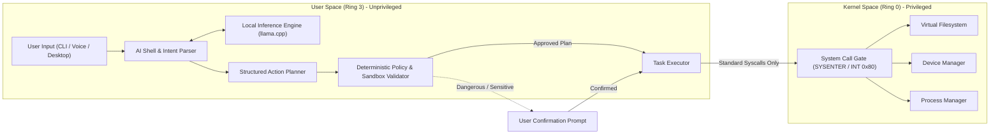

# Eran OS Offline AI Architecture & Security Specification

## 1. Vision and Architectural Boundaries

The Eran OS AI Assistant is an integrated, local productivity agent designed to provide natural language interaction, document summarization, system diagnostics, and approved OS task execution without relying on cloud inference.

### Core Architectural Principle: Kernel / AI Isolation

### Inviolable Safety Rules
1. **No Kernel Privileges for AI:** The AI model and inference runtime run entirely in Ring 3 user space. The AI engine never accesses hardware registers, kernel memory, or CPU control registers directly.
2. **Structured Actions Over Arbitrary Code:** The AI engine does not generate or execute arbitrary shell scripts or machine code. It generates strongly typed, schema-validated action plans.
3. **Deterministic Policy Validation:** Every proposed action is inspected by an independent, deterministic policy validator prior to execution.
4. **Offline Autonomy:** Core inference relies on quantized local weights (e.g., GGUF via llama.cpp). When no local model is loaded, the AI Shell gracefully falls back to deterministic built-in commands.

---

## 2. AI Subsystem Components

### 2.1 Interface & Shell (`ai-shell/`)
- Accepts keyboard text input, terminal commands, or transcribed voice audio.
- Distinguishes between standard deterministic OS commands (`ls`, `ps`, `cat`, `help`) and natural language requests ("Find documents modified today", "Lower volume to 20%").

### 2.2 Local Inference Runtime
- Runs quantized models locally using efficient CPU SIMD instructions (AVX2/AVX-512) or hardware acceleration where supported.
- Implements a modular provider interface so model runtimes (llama.cpp, embedded tiny models, or rule-based deterministic parsers) can be swapped seamlessly.

### 2.3 Intent Interpretation & Action Planning
- The inference engine maps natural language intents to strict action schemas:
  - `FileSearchAction`: query, path, recursive, max_results.
  - `DeviceQueryAction`: device_category, detailed.
  - `SettingChangeAction`: setting_key, target_value.
  - `ProcessInspectAction`: filter_name, sort_by.

### 2.4 Policy & Permission Engine
- **Path Canonicalization:** Resolves all relative paths against allowed working directories; rejects paths containing `..` or symbolic link traversals that escape the authorized workspace.
- **Destructive Action Guards:** Actions involving file deletion, disk formatting, network reconfiguration, or shutdown require explicit interactive user confirmation before execution.
- **Dry-Run Mode:** Supports evaluating the impact of an action plan without applying state changes.

### 2.5 Action Executor
- Translates approved structured actions into standard POSIX/Eran OS system calls (`read`, `write`, `open`, `ioctl`).
- Enforces execution timeouts and resource limits to prevent runaway tasks.

---

## 3. Staged Implementation Plan

1. **Phase 15 (Host-Side Prototype):**
   - Built in Python on Ubuntu host environment (`ai-shell/src/eran_shell/`).
   - Validates schema generation, intent interpretation, and sandboxed file operations.
   - Provides deterministic fallback commands for all core OS queries.

2. **Phase 16 (Local Model Integration):**
   - Incorporates `llama.cpp` Python bindings with small, offline quantized language models (e.g. 1B - 3B parameter models).
   - Validates offline document search and error explanation.

3. **Phase 17 (Voice Assistant Integration):**
   - Adds local speech-to-text (e.g., Whisper.cpp) and offline text-to-speech synthesis with visual recording status indicators.

4. **Phase 18 (Native OS Service Port):**
   - Ports the validated AI Shell and lightweight inference engine to native C/C++ running directly as an unprivileged Eran OS Ring 3 user daemon once multitasking and memory management are operational.
