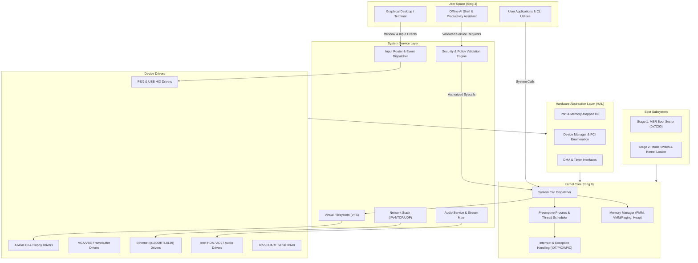

# Eran OS Architecture Specification

## 1. System Vision and Core Principles

Eran OS is a custom operating system designed from the ground up using low-level systems programming. It evolves methodically from a bare-metal x86 bootloader into a modular, secure, hardware-aware multitasking kernel, accompanied by a local, offline AI productivity assistant.

### Foundational Principles
1. **Real Operating System:** No web mockups, simulations, or prepackaged kernels masquerading as custom work. Subsystems are implemented in assembly and C.
2. **Strict Privilege Separation:** The offline AI engine and user applications run outside privileged kernel space. The AI engine interacts with the operating system strictly through authenticated, validated system calls and service APIs.
3. **Hardware-Aware Hardware Abstraction Layer (HAL):** Device drivers interface with hardware through a structured HAL rather than hardcoded port writes scattered across the codebase.
4. **Offline Autonomy:** Core operating system functionality and AI assistance operate independently of cloud infrastructure or remote telemetry.
5. **Transparency & Empirical Verification:** Hardware capabilities and subsystem status are reported truthfully based on verified emulator or physical hardware tests.

---

## 2. Layered Architecture

---

## 3. Subsystem Evolution Path

### 3.1 Boot & Processor Mode Transition
- **Current State (Phase 1):** 16-bit real mode master boot sector at physical address `0x7C00`, normalizing segments, initializing stack at `0x7C00`, enabling COM1 serial diagnostic output, preserving boot drive ID in `DL`.
- **Target State (Phase 2 & 3):**
  1. Bootloader reads Stage 2 sectors from disk into RAM using BIOS `INT 13h`.
  2. Enables the A20 address line (via keyboard controller 0x64 or Fast A20 port 0x92) to overcome the 1 MB real mode boundary.
  3. Loads the Global Descriptor Table (GDT) defining flat 4GB code and data segment descriptors.
  4. Sets the Protection Enable bit (`CR0.PE = 1`) and executes a far jump to flush the prefetch queue into 32-bit Protected Mode.
  5. Sets 32-bit stack and transfers control to the freestanding C kernel entry point (`kmain`).

### 3.2 Kernel Core & Interrupt Infrastructure
- **Interrupts & Exceptions:** Establish the Interrupt Descriptor Table (IDT), remap the legacy 8259 Programmable Interrupt Controller (PIC) IRQs (0-15 to 32-47) to avoid collision with CPU exceptions (0-31), install ISR stubs, and register timer (IRQ 0) and keyboard (IRQ 1) handlers.
- **Memory Management:**
  - *Physical Memory Manager (PMM):* Bitmap or buddy allocator tracking free 4KB physical page frames.
  - *Virtual Memory Manager (VMM):* Two-level x86 paging (Page Directory and Page Tables), identity-mapping the kernel and mapping user processes into isolated address spaces.
  - *Kernel Heap:* `kmalloc` and `kfree` implementation managing dynamic kernel data structures.
- **Multitasking & Scheduling:** Process Control Blocks (PCB), round-robin preemptive scheduler driven by the PIT timer interrupt, hardware context switching, and Ring 3 user mode privilege transitions.

### 3.3 Hardware Abstraction Layer (HAL) & Device Driver Model
- Hardware interaction is centralized in the HAL (`hal/`):
  - In/out port abstractions (`inb`, `outb`, `inw`, `outw`).
  - MMIO accessors with compiler barriers.
  - PCI bus scanning to enumerate device IDs and assign resources.
- Driver Interface: Each driver implements standard lifecycle hooks:
  - `probe()`: Identifies hardware presence.
  - `init()`: Allocates buffers, registers interrupt handlers, initializes hardware registers.
  - `read()` / `write()` / `ioctl()`: Standard I/O interfaces.
  - `shutdown()`: Quiesces device on reboot/powerdown.

### 3.4 Storage & Virtual Filesystem (VFS)
- Block layer abstractions decoupling storage controllers (IDE/ATA, AHCI, Floppy) from filesystem implementations.
- VFS providing standard POSIX-like operations (`open`, `read`, `write`, `close`, `stat`, `readdir`).
- Initial support for FAT12/FAT16 filesystems for maximum interoperability, progressing to custom file storage.

### 3.5 Input & Graphics Subsystems
- Keyboard driver supporting scancode set 1/2 translation, modifier key states, and circular FIFO input queues.
- Mouse driver supporting PS/2 packet decoding and cursor coordinate updates.
- Transition from VGA 80x25 text mode (`0xB8000`) to VESA BIOS Extensions (VBE) linear framebuffer for graphical rendering (software blitting, font rasterization, desktop compositing).

---

## 4. Offline AI Productivity Assistant Integration

The Eran OS AI assistant is an autonomous local productivity agent. Crucially, the AI runtime does **not** reside within the kernel address space.

### 4.1 Host-Side Development & Staged Porting
1. **Host-Side Prototype (Phase 15):** The AI Shell is developed initially as a host-side Python service on Linux. It interfaces with local quantization runtimes (`llama.cpp`) to prove structured planning, intent classification, and policy enforcement.
2. **Freestanding Integration (Phase 18+):** Once Eran OS supports user-mode processes, C runtime libraries, dynamic memory, and disk storage, a native C/C++ lightweight inference engine is ported to run as a Ring 3 user daemon.

### 4.2 Security Architecture for AI Interactions
- **Structured Action Schemas:** The AI model never emits raw shell commands or unvalidated assembly instructions. It outputs strictly typed JSON/binary action records (e.g., `ReadFileAction`, `AdjustVolumeAction`, `ListDevicesAction`).
- **Policy & Permission Engine:** Every proposed action passes through a deterministic policy validator that verifies path canonicalization, prevents directory traversal, checks file permissions, and prompts the user for destructive actions (e.g., file deletion, device reconfiguration).
- **Least Privilege Execution:** The executor daemon operates with unprivileged user credentials and interacts with the kernel solely through standard audited system calls.
